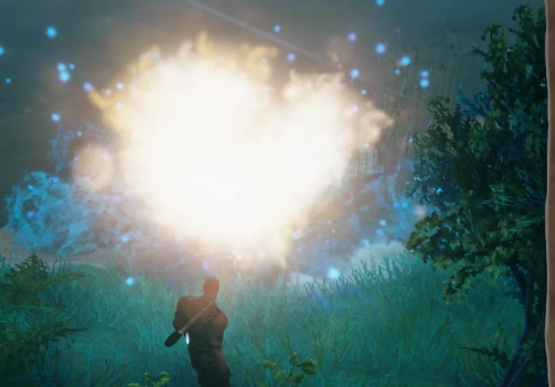
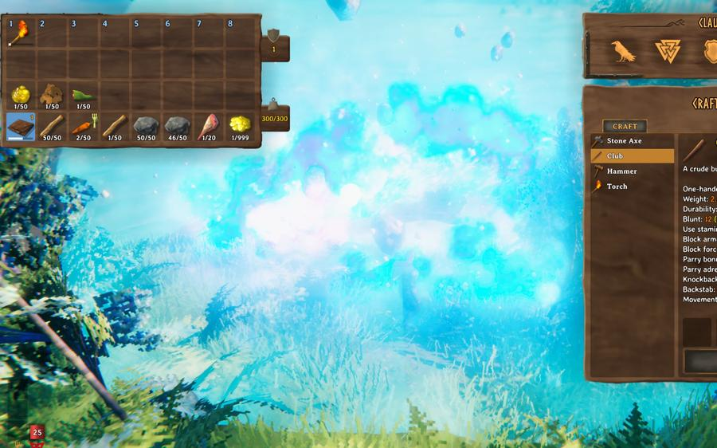
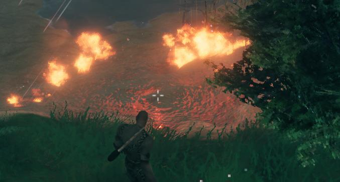
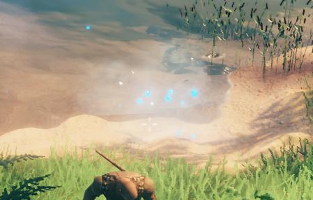
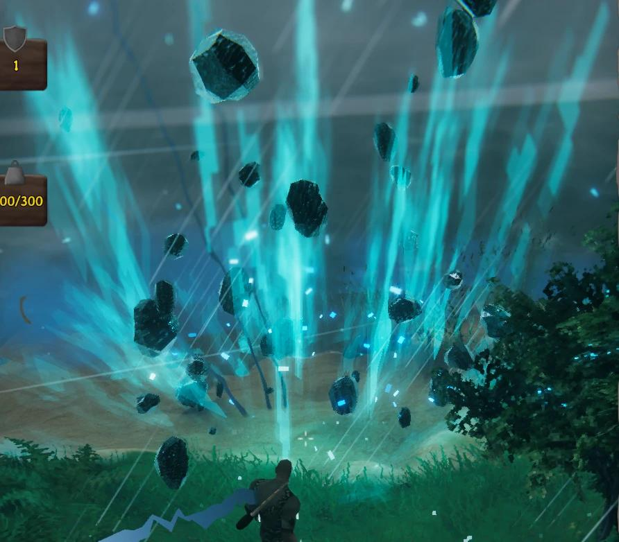
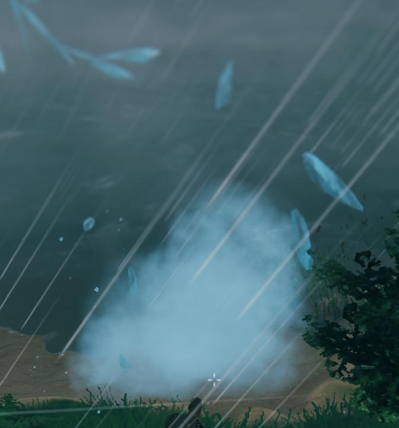
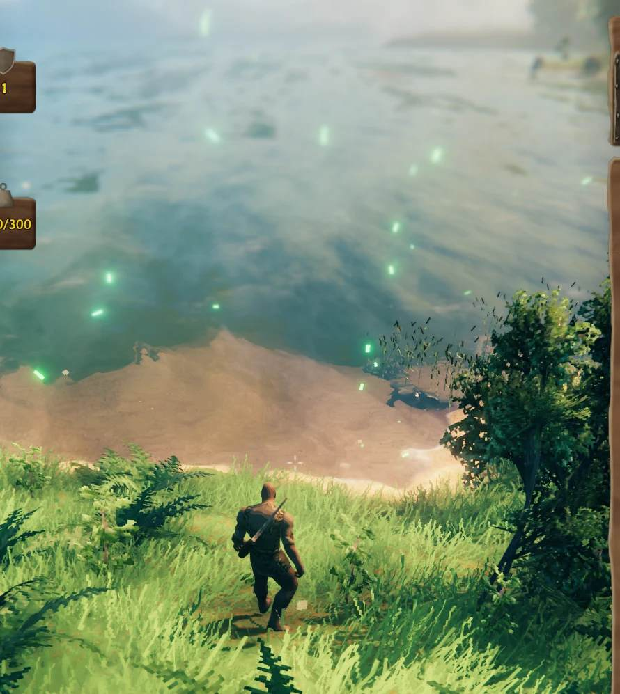
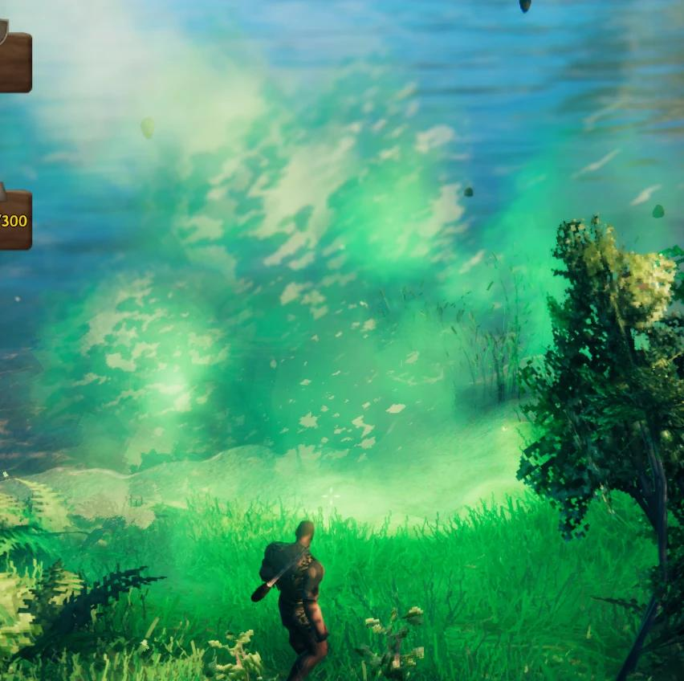

# FX: Valheim effect library

Effects tested on 2026-10-24 in our own world `ClaudeTest`, one at a time at the crosshair, through the HomeCheat plugin's `visualeffect` command. Our own game and world only.

## How to fire one

Drop a file into `BepInEx/config/homecheat/inbox/<unique-name>.cmd`, read the answer from `outbox/<unique-name>.out`:

```
op=visualeffect&name=_probe&prefab=fx_Lightning&at=aim&duration=8
```

- `at` = `aim` (crosshair, default), `self`, or `x,y,z`. The effect is put on the ground (never below it): `lift=0.2` raises it, `ground=0` keeps the raw height.
- `duration` removes it after N seconds. `scale` resizes it (networked prefabs).
- Strikes spreading from the centre outwards (rings): add `pattern=outward&rings=3&step=6&itemsize=10&delay=3` (needs the command's catalog name, e.g. `name=thunderstomp`).
- Verified catalog names in the command: `lightning`, `lightningred`, `explosion`, `fireball`, `nova`, `thunderstomp` (see the table below for their prefabs).
- Do not run several test scripts at once: a stopped wrapper can leave a script running that keeps firing effects.

## fx_ versus vfx_

Only a naming habit of the game's developers, no technical difference. `fx_` prefabs are mostly effects of actions (attacks, spells, area hits, boss moves), `vfx_` prefabs mostly effects that happen to things (hit, death, destroyed, burning, a status). Both are ordinary prefabs spawned the same way, and both can carry particles, a light, a sound and a camera shake. Example: `vfx_Burning` has 6 particle systems, a flickering light and 2 sounds. A third kind, `sfx_`, is sound only.

Most of these prefabs have a `ZNetView`, so they are networked objects: spawned on the host they show up for other players too (not tested with a second player).

## Tested effects

Size is how it looked on screen: small, medium, big, huge; where Maksym did not say a size, it is my estimate from his description. Screenshots exist only for some (the first ones were sent inline and not saved).

### Lightning

| Prefab | Looks like | Size | Screenshot |
|---|---|---|---|
| `fx_Lightning` | small blue zigzag bolt with thunder | small | - |
| `fx_Lightning_red` | red sparks, red lightning | small | - |
| `fx_chainlightning_hit` | thin white lightning line from the sky to the point | small | - |
| `fx_chainlightning_spread` | small lightning effect on the ground | small | - |
| `fx_himminafl_aoe` | single lightning strike, looks like `fx_chainlightning_hit` | small | - |
| `fx_lightningstaffprojectile_hit` | small red lightning on the target | small | - |
| `fx_JotunWitch_LightningBolt_Explosion` | small violet lightning blast | small | - |
| `fx_eikthyr_forwardshockwave` | a series of lightnings going forward in the direction the effect faces (a line, not a point) | medium | - |
| `fx_eikthyr_stomp` | huge lightning shockwave with flying rocks, camera shake | huge | - |

### Fire and explosions

| Prefab | Looks like | Size | Screenshot |
|---|---|---|---|
| `fx_dynamite_explosion` | orange fire burst | big | - |
| `fx_fireball_staff_explosion` | fire with black smoke, camera shake | big | - |
| `fx_lavabomb_explosion` | flame burst with sparks and smoke | big | - |
| `fx_clusterbombstaff_hit` | dynamite-like blast | big | - |
| `fx_goblinking_meteor_hit` | big pink-red fire blast cloud, covers the player | huge | - |
| `fx_fimbulvinter_meteor_hit` | blue dynamite-style explosion, white-yellow flash with blue sparks | big |  |
| `fx_goblinking_nova` | huge blue flame explosion around the player | huge |  |
| `fx_fireskeleton_nova` | small ground flames, a ring of fire patches | small |  |
| `fx_goblinbrute_groundslam` | small ground boom | small | - |

### Ice and frost

| Prefab | Looks like | Size | Screenshot |
|---|---|---|---|
| `fx_iceshard_hit` | small ice blast, blue sparks and mist | small |  |
| `fx_frozenking_spikerain_hit` | big ice blast | big | - |
| `fx_frozenking_punch_aoe` | ice cast: tall cyan ice spikes with flying dark ice chunks | big |  |
| `fx_icicle_destruction` | ice fall: blue shards and a white mist puff | medium |  |
| `fx_fenring_icenova` | faint blue mist and sparkles ("frost waves") | small | - |

### Rings, glows, other

| Prefab | Looks like | Size | Screenshot |
|---|---|---|---|
| `fx_DvergerMage_Nova_ring` | big cyan expanding ring on the ground | big | - |
| `fx_GP_Activation` | pink glowing orb on the ground | small | - |
| `fx_Fader_Roar` | floating green lights over the ground | small |  |
| `fx_fader_meteor_hit` | big green blast, green smoke cloud | big |  |

## Skip list

- `fx_frozenking_spikesmash`: a huge black-green stone slab that blocks the view. Maksym: do not use. (A green look is odd for a frost prefab, so the screenshot may belong to a leftover effect from an earlier script; recheck before relying on it.)

## Not described yet

- `fx_fader_meteorsmash` (fired, no description received).
- Still to test from the candidate list: `fx_blobLava_explosion`, `fx_Adrenaline1`, `fx_crit`, `fx_BonusYield`, `fx_Immobilize`, `fx_creature_tamed`, `fx_guardstone_activate`; `vfx_Burning` (fired once, not described), `vfx_Burning_blue`, `vfx_Burning_green`, `vfx_Cold`, `vfx_FireballHit`, `vfx_ColdBall_Hit`, `vfx_dragon_coldbreath`, `vfx_darkland_groundfog`, `vfx_BombBlob_explode_frost`, `_lava`, `_poison`, `vfx_creature_soothed`, `vfx_bjorn_groundslam`; sounds `sfx_bombdynamite_explosion`, `sfx_dragon_scream`, `sfx_dragon_coldbreath_start`, `sfx_dragon_coldball_explode`, `sfx_dverger_ice_aoe_start`, `sfx_dverger_fireball_rain_start`.

## Weather and time (names read from the game, effect not tested yet)

Forced environments that revert on a timer (`name=_envs` lists them): `Rain`, `LightRain`, `ThunderStorm`, `Eikthyr`, `Snow`, `SnowStorm`, `Misty`, `DeepForest Mist`, `Ashlands_meteorshower`, `Ashlands_CinderRain`, `Ashlands_storm`, `Mistlands_thunder`, `Darklands_dark`, `Fader`, `GoblinKing`, `Bonemass`, `Twilight_Snow`. Weather, time of day, light and camera shake affect only the local player.

## Description files (all effect prefabs)

One table per prefix, every prefab of the prefix once (counts in game, 2026-10-24): `| effect id | effect name | effect description | side notes |`. In `fx_` and `vfx_` the description says first what you see (colours, shapes, motion, glow), then after "Game:" what the game uses it for; sounds, camera shake and duration sit in side notes. Written from a dump of the game (components, particle colours, materials, sound clip names, and which prefabs spawn each effect, e.g. `fx_Eat_Red` is the eat effect of red foods); the ✔ rows are the effects tested above and start with what Maksym saw and the size he gave. The base for a skill that picks effects for actions (hit, heal, explosion, thunder): grep an action word in these files.

- [fx_descriptions.md](fx_descriptions.md): 281 `fx_` prefabs (actions, spells, boss moves, creature hit/death, crafting).
- [vfx_descriptions.md](vfx_descriptions.md): 487 `vfx_` prefabs (things being hit, destroyed, placed, burning, potions, deaths).
- [sfx_descriptions.md](sfx_descriptions.md): 791 `sfx_` prefabs (sound only; meaning comes from clip names and users, not from listening).

Found while building them: `fx_frozenking_spikesmash` is a copy of `fx_fader_meteorsmash` (same components, a green light and the same meteor sound), which explains the green slab seen in the skip list above.

## Files and source

The command source is [src/Features/VisualEffect](../../src/Features/VisualEffect/) (HomeCheat command DLL, built with `bash build.sh visualeffect`; the read-only prefab inventory behind the description files is [src/Features/FxDump](../../src/Features/FxDump/), `op=fxdump`); the full test log with the order they were fired is in the working folder `LocalOutputs/2026-10-24--00-48/` (not kept long-term). Screenshots are 900 px JPEGs taken in game by Maksym.

## In-game test 2026-10-25

Maksym's test pass of the phase 4 commands, world `ClaudeTest` hosted on this PC, Claude2 (no mod) as the second player.

- The probe got `speed=` (x the particles' `simulationSpeed`, (0, 10]) and its `scale=` now switches particles to hierarchy scaling and shrinks lights (`name=_probe&prefab=&scale=&speed=`).
- Ice sets v2 replayed at scale 0.5, speed 2: "good". In a set the sound comes first: all prefabs of a mine spawn in the same frame, so the preview order (one probe at a time) is not the play order. The mine blast sets built from these previews: [traps.md](../Spells/traps.md#in-game-test-2026-10-25).
- Detonation looks: 10 combinations previewed at the crosshair; Maksym picked 3 + 10 together (`fx_JotunWitch_LightningBolt_Explosion`, `vfx_spawn_small`, `sfx_staffthunderblood_cast`, `sfx_FireAddFuel`) at size 2.
