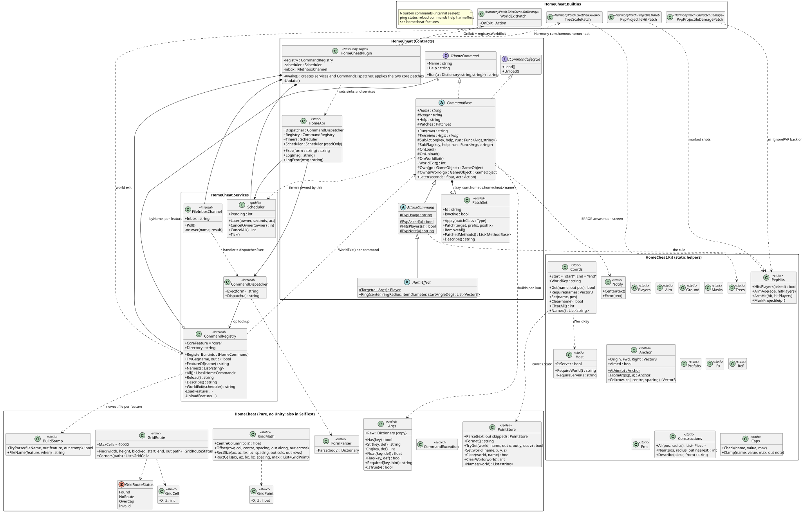

> Copy of `docs/homecheat-architecture.md` from the ValheimMods repository, written by the HomeOS package build; edit the original.

# HomeCheat architecture

Restructured 2026-10-25 from one 880-line plugin class plus flat command files. Valheim 1.0.20, BepInEx 5.4.2351, C# 5 (csc 4.0 that ships with Windows). Package: [GameplayEnhancements](../../README.md), sources: [GameplayEnhancements/src/](../../src/), command index: [docs/HomeCheat-plugin/README.md](../HomeCheat-plugin/README.md), command catalog (what each command changes, extend-or-new rules): [homecheat-commands.md](homecheat-commands.md), class diagrams: [diagrams/](diagrams/) (PlantUML sources and SVG). Paths below are relative to `GameplayEnhancements/`.

## Two kinds of DLL

| DLL | Holds | Changes need |
|---|---|---|
| `BepInEx/plugins/HomeCheat.dll` (core) | contracts, services, shared helpers (`Kit`), six built-ins, three core patches (tree scale on load, clean-up on world exit, the PvP flag on marked projectile hits) | a game restart: BepInEx loads it once |
| `BepInEx/homecheat-commands/HomeCheat.Cmd.<feature>.v<yyyyMMddHHmmss>.dll` (one per feature) | the commands of one feature folder | `op=reload`, no restart |

Rules:
- The core holds what is stable. A helper moves into the core only when two or more features use it and it has stopped changing; until then it stays in its feature.
- Features never reference each other's types. They are separate assemblies, reloaded independently. One feature calls another only through `HomeApi.Exec("op=...")`, the same path the inbox uses (the spell bar does this for every cast).
- Only the newest stamp of each feature loads, compared as a number (old 6-digit `hhmmss` stamps lose to new 14-digit ones, and a build after midnight beats one before it).
- .NET 4 cannot unload an assembly. A replaced build stays in memory until the game restarts; it is unloaded logically (its patches, objects and timers are removed).

```
HomeCheat.dll (core)                                      HomeCheat.Cmd.<feature>.dll (hot reload)
 HomeCheatPlugin      Awake/Update only, wires services    Features/World        give spawn list place plant field cultivate
 Contracts            IHomeCommand, ICommandLifecycle,                           repair refill groundlevel path inspect scale coord harvest
                      CommandBase, AttackCommand,                                + FieldAnchor FieldPatch CropSpacing TerrainOps GrowRules
                      HarmEffect, PatchSet, HomeApi        Features/Diag         cheatstate cheatinfo
 Pure (no Unity)      Args, CommandException, FormParser,  Features/Earthquake   earthquake      (HarmEffect)
                      BuildStamp, GridMath, GridPoint,     Features/Slime        slime           (HarmEffect)
                      GridRoute, GridRouteStatus,          Features/Spellshot    spellshot       (AttackCommand)
                      GridCell, PointStore                 Features/Heal         heal cleanse bless
 Services             CommandRegistry, CommandDispatcher,  Features/Spells       spells (bar, radial, form, spell file, patches)
                      FileInboxChannel, Scheduler          Features/Transform    transform + TransformForm (Raven/Serpent/Fish), State/Remote/Landing/FallPatch
 Kit                  Players, Aim, Ground, Masks,         Features/HideBody     hidebody + 3 patches, PublicPositionGuard
                      Anchor, Prefabs, Fx, Trees, Refl,    Features/KillMobs     killmobs
                      Fmt, Host, Coords, Constructions,    Features/VisualEffect visualeffect
                      Caps, Notify, PvpHits                Features/FxDump       fxdump
 Builtins             ping status reload commands help     Features/Keybinds     keybinds + 4 patches
                      harmeffect, TreeScalePatch,          Features/Ship         ship
                      WorldExitPatch, PvpProjectilePatch   Features/Dome         dome + DomeWards DomeLayout DomePatches DomeMenu DomePlayers DomeNumbers DomeShow DomePoint WardState
                      (PvpProjectileHitPatch +             Features/Traps        trap (AttackCommand) + TrapKind TrapWeapon TrapFxSet TrapPatches
                      PvpProjectileDamagePatch)            Features/Despawn      despawn
                                                           Features/Construction construct + Blueprint*, PieceGhost, TerrainLevel, FitField, MaterialSwap, ConstructPanel, ConstructPatches, PreviewDoors
```

Flow of one command: `BepInEx/config/homecheat/inbox/<name>.cmd` -> `FileInboxChannel` (poll 0.5 s, at most 20 files per poll, main thread) -> `CommandDispatcher` (form -> parameters, `op` lower-cased -> command) -> `CommandRegistry` lookup -> `CommandBase.Run` (sub-action or `Execute`) -> answer text -> `outbox/<name>.out` (written as `.tmp`, then moved).

## Class diagrams

Sources are PlantUML in [diagrams/](diagrams/). After a change, render them with `java -jar plantuml.jar -tsvg docs/diagrams/*.puml`; every file starts with `!pragma layout smetana`, so no Graphviz is needed.

### Core: contracts and services



### Who inherits what, by DLL

Every command derives from `CommandBase`. Commands that damage or push characters derive from `AttackCommand : CommandBase` (the PvP rule): `spellshot` and `trap` directly, the two effects aimed at a player through `HarmEffect : AttackCommand`. Nothing goes deeper. One box is one DLL; the helper types of a feature sit in its box.


Each command in the single-command boxes is its own DLL (`earthquake`, `slime`, `spellshot`, `spells`, `transform`, `hidebody`, `killmobs`, `visualeffect`, `fxdump`, `keybinds`, `ship`, `dome`, `traps`, `despawn`, `construction`), except `heal`, `cleanse` and `bless`, which share the `heal` DLL.

### Composition: the spell bar (the largest feature)


A cast goes `SpellBar.CastSpell` -> the spell's `Cmd` from the spell file (the Shift form appended when Shift is held), split on `;;` -> `HomeApi.Exec("op=heal")` for each part -> the dispatcher -> `HealCommand` in another DLL: features never reference each other's types.

Spell file v4 (2026-10-25): `SpellParse` (no Unity reference) reads the file into a tree of `SpellNode`s (dotted ids of any depth, titles, sticky inherited from a title) holding `Spell`s; `SpellGroupConfig` shows one title's level; the game's ring holds 8 to 12 entries (`RadialDataSO.MaxElementsRange`, probed [8,12]) and lays out a longer level as a spiral, so plan a level to fit one ring (the Hotbar was split into Panel 1-5 and Panel 6-0 for this). A spell with `ask=` flags opens one form screen, `SpellForm` (since 2026-10-25; it replaced the radial answer chain `SpellAskConfig`): every question at once (`SpellAsk`, answers `SpellAskOption`, dynamic answers from `SpellAskSources`), buttons for fixed answers, an icon grid with search for `@prefabs`, a question greyed and left out while its condition fails; Cast collects the answers in a `SpellAskChain` and calls `SpellBar.CastChain` -> `CastSpell`, which puts each answer into `{key}` (`SpellParse.Substitute`, URL-escaped) before the `;;` split. So a command that needs a choice from the player (a prefab, a count, an area) takes plain parameters, and the choice is made in the spell file; it holds no menu code of its own. Format and limits: [spellbar.md](../Spells/spellbar.md#spell-file-v4).

## Main classes

| Class | Role |
|---|---|
| `HomeCheatPlugin` | BepInEx entry point. Creates the services and the dispatcher, fills `HomeApi`, hands the loaded `HomeCheat` assembly to the command DLLs (`AssemblyResolve`), applies the core patches `TreeScalePatch`, `WorldExitPatch` and `PvpProjectilePatch`, registers the built-ins, loads the feature DLLs, ticks the scheduler and polls the inbox. Nothing else. |
| `CommandRegistry` | every command by name and the feature that provides it; loads the newest build per feature from bytes (the file is never locked), unloads the build it replaces, refuses a name another feature already owns (the rest of that DLL still loads); the feature name `core` is reserved for the built-ins |
| `CommandDispatcher` | form text -> parameters -> command -> answer; main thread only |
| `FileInboxChannel` | the file channel (`inbox/*.cmd` -> `outbox/*.out`); no network port |
| `Scheduler` | main-thread timers with an owner, on `Time.time` (they wait while the game is paused); unloading the owner cancels its timers, leaving the world cancels all of them (`CancelAll`) |
| `WorldExitPatch` | core postfix on `ZNetScene.OnDestroy` (logout, lost connection, quit); calls `CommandRegistry.WorldExit`: each command's `OnWorldExit`, its timers and its `OwnInWorld` objects are cleared, then any timer left |
| `HomeApi` | the one static entry point for feature code: `Exec`, `Log`, `LogError`, `Scheduler` |
| `Args` | typed parameters: `Str`, `Int`, `Float` (InvariantCulture), `Flag` (1/true/yes/aim; empty or missing = the default), `Has`, `Required` (throws), `Raw` (a copy, to forward to another command) |
| `CommandBase` | base of every command (below) |
| `AttackCommand` | base of every command that damages or pushes characters (2026-10-25, core): the opt-in `pvp=` rule, `PvpUsage` for `Usage`, `PvpAsked(a)`, `HitsPlayers(a)` (pvp=1 and your PvP on), `PvpNote(a)` for the first answer line; the hits themselves through `Kit.PvpHits` |
| `HarmEffect` | base of effects aimed at a player (`: AttackCommand`): `Target(a)`, `Ring(...)`; reachable as `op=harmeffect&kind=<name>` too |
| `Kit.PvpHits` + `PvpProjectilePatch` | the PvP rule applied: `ArmAoe(aoe, hitPlayers)` (owner never hit; `m_hitFriendly`, `m_hitSame`, `m_ignorePVP` = hitPlayers), `ArmHit(hit, ...)`, `MarkProjectile(pr)`. The game's `Projectile.Setup`/`OnHit` drop `HitData.m_ignorePVP`, so the core patch (prefix/postfix on `Projectile.OnHit`, prefix on `Character.Damage(HitData)`) puts it back on hits of marked shots; leaving the world forgets the marks |
| `Kit.Notify` | messages to the player in the game's style: `MessageHud` centre text, first line, 140 characters, local only; the wrap at 50 characters and 70 % size is in the source and installs at the next core restart (the running core shows one line). `CommandBase.Run` shows every `ERROR` answer (thrown or returned) through `Notify.Error`; nothing else is shown on success (notification policy, Conventions) |
| `PatchSet` | the Harmony patches of one command under one id (`com.homeos.homecheat.<command>`); applied per patch class (`Apply`) or per method found by reflection (`Patch`), removed on unload |
| `Kit.Host` | world and host guards: `RequireWorld()` (net scene, zones and ObjectDB loaded; returns the world name), `RequireServer()` (also: this game hosts the world), `IsServer` |
| `Kit.Coords` + `PointStore` | named points per world (`start`, `end`, any name) in `BepInEx/config/homecheat/coords.state`; in the core so they survive feature reloads; the text format and limits are the Unity-free `PointStore` (64 points per world, names up to 32 letters, digits, `_`, `-`) |
| `GridRoute` | A* on an integer grid (8 neighbours, no corner cutting, start and end always passable, grids over `MaxCells` = 40 000 refused); `Corners` turns the cells into the polyline to stamp along |

## Inherit or compose

OOP is used, but shallow. Unity and Valheim are built from components, and their types are not ours to subclass. The exceptions are `BaseUnityPlugin` (the plugin), `MonoBehaviour` (`SpellBar`, `TransformState`, `TransformRemote`, `TransformLanding`, the feature-owned windows `DomeMenu` and `ConstructPanel`) and the game's `IRadialConfig` (the five `Spell*Config` classes: `SpellRootConfig`, `SpellPanelsConfig`, `SpellHotbarConfig`, `SpellGroupConfig`, `SpellLeafConfig`). Feature-internal bases are allowed where variants share behaviour: `TransformForm` (`RavenForm`, `SerpentForm`, `FishForm`).

- **Inherit** when something is a kind of command with a shared lifecycle or a shared rule: every command derives from `CommandBase`; a command that damages or pushes characters derives from `AttackCommand : CommandBase` (the PvP rule lives there, not in each command); player-targeted effects derive from `HarmEffect : AttackCommand`. Concrete commands are `sealed`. Nothing goes deeper than `CommandBase` -> `AttackCommand` -> `HarmEffect` -> effect.
- **Compose** when a command *has* something: Harmony patches (`Patches`), a GameObject (`Own(...)` until unload, `OwnInWorld(...)` until the player leaves the world), timers (`Later(...)`), effects (`Kit.Fx`), a grid (`Kit.Anchor`), a spell file (`SpellFile` inside the spell bar).

`CommandBase` is a template method. `RepairCommand` (shortened) shows every part:

```csharp
public sealed class RepairCommand : CommandBase
{
    public RepairCommand()                     // constructors only register sub-actions: no side effects
    {
        SubFlag("report", "report=1 [radius=10] (health of every piece around you, changes nothing)",
            delegate (Args a) { return Report(a.Float("radius", 10f)); });
    }

    public override string Name { get { return "repair"; } }
    protected override string Usage { get { return "repair [aim=1] [radius=10 (with aim=0)] [amount=0 (= full)] - building pieces back to full health"; } }

    protected override string Execute(Args a)  // the main action
    {
        bool aim = a.Flag("aim", true);
        Player p = Players.Local;              // throws "no local player: load a world first"
        float radius = a.Float("radius", 10f);
        if (!aim && radius <= 0f) throw new CommandException("radius must be > 0");   // answered as "ERROR: radius must be > 0"
        return "repaired ...";
    }
}
```

`Run` (not overridable) builds `Args`, tries the sub-actions in registration order (`SubAction` = the key has a non-empty value, `SubFlag` = the key is 1, true, yes or aim), else calls `Execute`. A `CommandException` becomes `ERROR: <message>`; any other exception is logged with its stack trace and answered the same way. `Help` = `Usage` plus the help texts of the sub-actions, joined with ` | `.

## Lifecycle and hot reload

1. The registry loads the new DLL from bytes and constructs every non-abstract `IHomeCommand` type with a public parameterless constructor. Constructors only set fields and register sub-actions. A command whose name another feature (or a built-in) owns is dropped here, with a `FAILED` line in the answer.
2. It unloads every command of the feature's previous build: `OnUnload()` first, then the base class cancels the command's timers, removes its patches and destroys its owned GameObjects (even when `OnUnload` throws).
3. It registers the new commands and calls `OnLoad()` on each: apply patches, create GameObjects, read settings files. A command whose `OnLoad` throws stays registered; the answer shows `FAILED load of <name>`.

Built-ins are registered once by the plugin and get `OnLoad()` at that moment; they are never replaced.

Leaving the world (logout, a lost connection, quit) is a second, smaller clean-up. The core's `WorldExitPatch` is a postfix on `ZNetScene.OnDestroy`, which runs on every exit (`Game.Logout` is not enough: it can wait on a disk-space dialog, and a client that loses its host never calls it; checked with `il-reader.js` on 1.0.20). It asks the registry to call `WorldExit` on every command: `OnWorldExit()` first, then the command's timers are cancelled and its `OwnInWorld(...)` objects destroyed; last, the scheduler cancels every timer that is left, whatever its owner. Patches and `Own(...)` objects stay, because the next world uses them again (the spell bar is an `Own` object that lives across worlds). The net scene is going away, so world objects are destroyed locally: a networked object's ZDO stays in the save, which is why persistent objects carry a ZDO mark for a later `clear=1`. Log line: `world exit: <n> commands, <n> timers and objects cleared, <n> other timers cancelled`.

State lives in instance fields. Harmony patch classes are static, so they reach the loaded command through `static <Command> Current`, set in `OnLoad` and cleared in `OnUnload`; a patch does nothing while `Current` is null. Example: `KeybindsCommand.Current`, `HideBodyCommand.Current`, `SpellsSettings.Current`.

Consequences to know:
- Leaving the world cancels every pending timer: an effect started in one world never finishes in the next. Earthquake stones placed just before then stay until `clear=1`, as after a reload.
- A reload cancels the pending timers of the old build. Earthquake stones placed before the reload then never break on their own; `op=earthquake&clear=1` removes them (they are marked in their ZDO).
- `transform` takes its components off the players on unload, so a new build starts from the human form.
- `hidebody` switches itself off on unload and on quit.
- Harmony patches on game UI methods are applied only once a world is loaded, never during plugin start: the spell bar's `RadialBase.Open` / `UseHotbarItem` patches at start froze the main-scene load (2026-10-25). `SpellPatches.EnsureApplied` applies them from `SpellBar.Update` when the local player exists, or right away on an `op=reload` inside a world; `op=spells&enabled=1` inside a world applies them through `SpellPatches.Apply`. If applying fails, spells switch off and `spells.state` remembers it.
- A feature build that fails to compile leaves the previous build loaded: check that `op=reload` names the new file before testing it.

## Feature notes (2026-10-25)

Behaviour that shapes the code, checked in game on 2026-10-25. The full parameters are in each command's help (`op=help&cmd=<name>`) and the [command index](../HomeCheat-plugin/README.md).

- **World grid anchors.** `cultivate` and `field` lay their grid from the player (`FieldAnchor.AheadOfPlayer`): row 1 is your own cell (`dist=0` by default), centred on your flat look direction, rows running away from you. Both use the same anchor, so the crops land exactly on the cultivated cells. `plant` and `place` still start at the crosshair (`Kit.Anchor`).
- **field spacing.** Without `spacing=`, `field` uses the crops' minimum legal distance from the game's data (`CropSpacing`): the sapling's `m_growRadius` plus its collider radius, the largest over all crops in `crops=` (carrot 0.68 m). Fallback 1.5 m.
- **field plants only connected soil.** Only cultivated cells joined to your own cell through cultivated cells (all 8 neighbours) are planted. A gap of uncultivated soil ends the field there; with your cell uncultivated nothing is planted. `map=1` prints the grid (`@` your cell, `#` connected, `o` cut off, `.` no soil). Limits: 40 000 cells examined, 10 000 crops planted per cast (batches of 500; cast again for the rest). The flood fill is `FieldPatch.Connected` (feature World), shared with the area modes below.
- **Terrain commands** (`groundlevel`, `path`, since 2026-10-25) write saved `TerrainOp`s through `TerrainOps` (feature World), never the hoe pieces' `TerrainModifier` objects: a level is one single-vertex operation per terrain vertex at the target height (the construct note below); a path is one paint operation per stamp with the hoe piece's paint type and smoothing and the radius `width/2 + 0.5 m` (the paint mask is a 1 m grid: a radius of `width/2` alone painted a visibly thinner strip, Maksym 2026-10-25). The tool's paint goes on a levelled area at the old stamp points (`raise` paints dirt). Old hoe stamps whose level or smoothing reaches the area are removed first (with `avoid=1` not those within 1 m of a building's pivot), then the operations follow 1 s later. Paint mask colours (`Heightmap.m_paintMask*`): dirt (1,0,0), cultivated (0,1,0), paved (0,0,1); paint over other paint mixes the channels, so a check reads only the type's own channel. Both commands have a read-only `report=1`: `groundlevel` measures the last levelled area against its target (or with `area=` the circle or rectangle against the median), `path` samples the last path's paint inside and 0.8 m outside its edges; `groundlevel` also logs the measurement after every job. Both reports end with the terrain zones under the area and how many another peer owns. A zone whose `TerrainComp` another peer owns drops every operation without a word, so `TerrainOps.Claim` takes those zones over first: `groundlevel` before every batch, `path` once before its operations, which all go out in one frame; the answer names the zones taken.
- **earthquake damage.** `damage=0` (default) only pushes. With `damage>0` every slam carries a hammer's damage: `weapon=SledgeStagbreaker` by default; `mode=strong` takes `SledgeDemolisher` and pushes 8.4 instead of 2.1; `weapon=auto` = the strongest `Sledge*` item (not `SledgeCheat`); `quality=max` by default, damage = base + per level x (quality - 1).
- **slime** casts effect set 2 by default (`fx=2`).
- **repair** has `report=1 [radius=10]`: the health of every piece around you, read from the ZDO, changing nothing.
- **cheatstate** reads, besides the achievement, terminal and profile flags: the player's debug-fly, god and ghost state, inventory items marked cheated, and cheated items, ragdolls and creatures within `radius=25`.

Built in wave 1 (2026-10-25), not yet run in game; the test lists are on the command pages ([build-terrain.md](../HomeCheat-plugin/build-terrain.md), [ship.md](../HomeCheat-plugin/ship.md), [spellshot.md](../Spells/spellshot.md)):

- **coord** is the player's front end to `Kit.Coords`: `set=start|end|<name>` (your position, or the crosshair with `aim=1`), `show=1`, `get=1`, `clear=1`. Other commands read the points with `Coords.Get` / `Coords.Require`; the command itself only stores them.
- **Keep away from buildings.** `groundlevel avoid=1` measures from the centre to the nearest player-built piece's pivot (`Constructions.Near`) over the area the stamp really changes: the larger of the hoe piece's smooth radius and radius + 1 m, not the level radius. It refuses, or with `shrink=1` levels a circle that stops 1.1 m short of that pivot (at least 1 m). A new keep-away check uses the same rule: the radius the game changes, plus a margin to the pivot.
- **path routing.** `path from=coords` stamps from the stored start to the stored end; `avoid=1` routes on a 1 m grid over both points plus a 10 m margin (`GridRoute`): a cell is blocked by `Ground.IsBlocked(cell, 0.6)` or a piece pivot within 1 m. Both stamp along the corner polyline (`GridRoute.Corners`).
- **Cut or refuse at a cap.** The old straight `path` refuses over 400 stamps; the opt-in `from=coords` and `avoid=1` modes stamp up to 400, stop, and name the cut in the first answer line. Cutting is allowed only in a new opt-in mode whose card decided it and only when the part made is useful on its own (a path that stops); an existing mode keeps refusing (no silent widening).
- **spawn at another player.** `player=<nick>` spawns ahead of that player; another player than you needs `Host.RequireServer()`. `yaw=` / `pitch=` are world angles. Item prefabs fall to the ground like any spawn.
- **Status effect on a projectile hit (harpoon).** The game's `Attack` puts the weapon's `m_attackStatusEffect` into `HitData.m_statusEffectHash`; `Projectile.Setup` keeps it when the prefab has none; `Character.RPC_Damage` adds it and calls `SetAttacker`. `spellshot` builds its own `HitData`, so `type=harpoon` sets `m_statusEffectHash` itself and the vanilla `SE_Harpooned` does the pull (IL, 1.0.20).
- **Temporary tuning of a game object (ship).** `ship` multiplies instance fields (`m_sailForceFactor`, `m_backwardForce`) of `Ship.GetLocalShip()`, always from the originals it kept per ship (x5 then x10 = x10), restores them in `OnUnload` and forgets them in `OnWorldExit`. Ship physics run on the ship's owner PC, and taking the helm does not move ownership, so when another PC owns the ship `ship` claims it (`ZNetView.ClaimOwnership`); `Ship.UpdateOwner` keeps it here while the local player stays aboard (works steering or sitting, W1-ship 0ac250e).

Built in wave 2 (2026-10-25), not yet run in game ([plant-field-place.md](../HomeCheat-plugin/plant-field-place.md), [dome.md](../HomeCheat-plugin/dome.md)):

- **Soil areas (field, cultivate, harvest).** `cultivate&area=coords` and `field&area=coords` lay a world X/Z grid over the rectangle of the stored start and end (`GridMath.RectCells`; cultivate 1.5 m, field the crop minimum); field plants every cultivated cell there, without the connection rule. `field&area=patch` and `harvest` work on the cultivated patch you stand on: `FieldPatch.Sample` grows it from your 0.5 m cell through cultivated cells (8 neighbours, at most 40 000 cells examined), and field plants the crop grid over its bounding box on cells inside it. `harvest` calls the vanilla `Pickable.Interact(player, false, false)` on every `Pickable` in the patch that `CanBePicked()`: the owner drops the items at each crop, so auto-pickup takes only the ones within reach. The area modes ignore `rows`, `perrow` and `dist` and say so.
- **A vanilla piece as if the player built it (dome).** `dome` instantiates `guard_stone` and repeats the steps of `Player.PlacePiece`: `Piece.SetCreator(playerId, PlatformManager.DistributionPlatform.LocalUser.PlatformUserID)` (needs `Splatform.dll` in `refs.txt`), `PrivateArea.Setup(profile name)`, `WearNTear.OnPlaced()`, the piece's `m_placeEffect`. The result is a normal ward of the local player for every vanilla client. Ward rules are horizontal only: `PrivateArea.IsInside` uses `Utils.DistanceXZ`, so a ward protects a vertical column.
- **Host-side state across a group of world objects (dome).** The host finds the objects by prefab and a ZDO mark (`ZDOMan.GetAllZDOsWithPrefabIterative`, one sector per call, true after the last; about 100 000 sectors), keeps them cached, rescans every 30 s, and polls them every 2 s with a self-rescheduling `Later` started from `OnLoad`, each command and a `Player.OnSpawned` postfix (leaving the world cancels it). A change is a state that differs from the signature last written to every member; it is copied to the others after taking each ZDO (`ZDO.SetOwner(ZDOMan.GetSessionID())`). An object loaded on the host changes through the game's own method (`PrivateArea.SetEnabled` by reflection: status and effects), a far one through its ZDO only.
- **A feature-owned window (dome ward menu, 2026-10-25).** `op=dome&step=menu` opens an IMGUI `MonoBehaviour` (`DomeMenu`, on a GameObject from `OwnInWorld`, drawn in `OnGUI` with the spell form's look and its own `Fill`/`Frame` helpers, since `SpellBar`'s are internal to Spells) and a postfix on `TextInput.IsVisible` that returns true while it is open, so the game frees the cursor and the player stands still. Apply calls the same method as the typed `step=apply`, so every click has a command form for tests. Use it when a form needs rows that depend on another answer or several picks at once, which the spell file's `ask=` form cannot do. `refs.txt`: `UnityEngine.IMGUIModule.dll`, `UnityEngine.TextRenderingModule.dll`.
- **Players who joined a world, offline too (dome).** The host records players per world in a file of its own (`BepInEx/config/homecheat/dome-players.state`, this PC only): the players online (`ZNet.GetPlayerList`, id from the character ZDO's `ZDOVars.s_playerID`) and every player on a ward's permitted list. A player who was never online while the host ran HomeCheat is not known.
- **A vanilla piece under the ground (dome, 2026-10-25).** A ward protects by horizontal distance (`PrivateArea.IsInside`), so `dome` buries every ward: instantiate on the terrain, sink it until the top of its renderers is 0.3 m under the ground, then `ZDO.SetPosition` to the new position (a piece has no transform sync, so every client creates it where the ZDO says). Water, buildings, slopes and rocks stop mattering. Wear seen in game: none in 40 s (no support wear; wet wear stops at half health by `WearNTear.UpdateWear`). Nobody can reach it with the hammer or E, so the command must offer every action on it (the ward menu).
- **Local per-world state files (dome).** What only this PC needs between sessions goes to `BepInEx/config/homecheat/<feature>-<thing>.state`, one line per world (`dome-players.state`, `dome-groups.state` for the highest Group-N ever given; `construct.state` holds construct's one plan per world). Never in the repository.

Built in wave 3 (2026-10-25), not yet run in game ([plant-field-place.md](../HomeCheat-plugin/plant-field-place.md#trees-in-an-area-since-2026-10-25), [tree-scale.md](../HomeCheat-plugin/tree-scale.md#the-tree-under-the-crosshair-since-2026-10-25), [repair-refill.md](../HomeCheat-plugin/repair-refill.md#fuel-by-type-since-2026-10-25)):

- **Trees (plant, scale).** `plant&area=coords` lays the sapling grid (twice the grow radius times the scale) over the rectangle of the stored start and end, is refused as a whole over 20 000 cells and plants at most 2 000 saplings per cast (cast again); `area=aim` names the old crosshair block. `avoid=1` skips a cell with a player-built piece within `clear` x `scale` + 2 m (`Constructions.Near`; the 2 m is the pivot margin) and counts it. `scale&aim=1` resizes only the tree under the crosshair (`Aim.SolidHit` 60 m, `GetComponentInParent<TreeBase>`), `filter=*` every tree in the radius. Both cap the size at 20 (`Caps.Check`): a scaled tree is seen at its size only where HomeCheat runs (`TreeScalePatch`).
- **Filter by an object's own data (refill).** `fuel=` matches the prefab name of `Fireplace.m_fuelItem` / `Smelter.m_fuelItem` (an `ItemDrop`); objects that do not match are counted as skipped, never changed. An opt-in filter on a command that acts on many objects uses the game object's own field, not a list of prefab names.
- **A trap that waits (trap, [traps.md](../Spells/traps.md)).** A vanilla prefab is used for its look only: `trap` places `piece_trap_troll` and leaves its `Trap` inert on every PC through the ZDO (`s_state = 0` unarmed, `s_triggered = 1e9` so `IsCoolingDown` stays true and `Interact` cannot arm it), because the trap's "who triggers" fields are prefab data that cannot be set per instance for every client. The host's watcher (self-rescheduling `Later`, 0.2 s while traps are live; `Player.OnSpawned` postfix as in dome) finds loaded traps by component and ZDO mark every 3 s, checks `Character.GetAllCharacters` against each trap's trigger radius, and hits with `Character.Damage` (no attacker, `HitType.EnemyHit`). Expiry is world time in the ZDO (`ZNet.GetTimeSeconds`, which stops while the world is not running). Every per-cast setting is written to the trap's ZDO, so a reload or the next world load changes nothing about a trap already laid.

In-game test pass of 2026-10-25 (Maksym with the test session; results per command on the pages, summary in the command index). Behaviour that changed and shapes new code:

- **One PvP rule for every attack (core).** Maksym: "if PvP is enabled on my player it should affect other players, independently of their setting", and the rule must live in the class the attack commands inherit from (Maksym's yes for the core change, gate 5). `pvp=1` (opt-in) on `spellshot`, `slime`, `earthquake`, `trap`: your PvP on = other players are hit whatever their own PvP, off = spared, never you. Facts from IL: `Character.RPC_Damage` drops a player-on-player hit while the victim's PvP is off unless `HitData.m_ignorePVP`; `Aoe.ShouldHit` skips the owner's own kind (`m_hitSame`) and non-enemies (`m_hitFriendly`); projectiles lose `m_ignorePVP` between `Setup` and `OnHit` (fixed by `PvpProjectilePatch`). `slime` with `pvp=1` owns its clouds, which also makes the target immune. Mines take the rule when laid (ZDO `hc_trap_pvp`): spared players neither set a mine off nor take its blast.
- **Thunderbolt pushed the caster.** `lightningAOE` holds a second `Aoe` (`AOE_ROD`, a 100 m box, attack force 100) besides the area one; only the biggest got an owner, so the rod hit everyone. Every `Aoe` of a strike now gets `Setup` (owner) and the rod's damage 0. Rule: arm every `Aoe` in a spawned prefab, not only the first or largest.
- **A game value through the game's own modifier hook (transform, 2026-10-25).** To change a number the game computes and then runs through status effects (fall damage: `Character.UpdateGroundContact` -> `SEMan.ModifyFallDamage(baseDamage, ref damage)` -> `Damage()` only when above 0), patch that hook with a postfix that edits the `ref` value (`TransformFallPatch`, argument by index `__1`) instead of the computing method: the rest of the game's step (landing effects, ground reset) still runs. Narrow the patch to whom it is for (the local player's `SEMan`, the form in its `TransformState`) and gate it on `Current`.
- **Every player must see it.** A local-only look was rejected twice: trees resized with `scale` are made again (`ZNetScene.Destroy` + `Instantiate` with the scale in the ZDO before it reaches others, the game's `m_syncInitialScale` applies it), and every transform form has a networked stand-in (`share`, `hide` default on; `TransformForm`). Claude2 (no mod) is the check.
- **Big jobs in batches.** `field` (10 000 per cast, 500 per step), `plant` (2 000, 100), `harvest` (10 000, 500), `groundlevel` (1 600 stamps of 4 m with `area=coords`, 150 vertices per step), `trap field=1` (5 000, 250) and `trap detonate=1` (waves of 25) spread their work over steps 0.1 s apart (`Later`), so neither a frame freezes nor the network floods; a cut names "cast again" in the answer.
- **Grow rules.** `field` and `plant` skip cells where the game would not let the plant grow (`GrowRules`, from `Plant.UpdateHealth`: `Heightmap` biome in `Plant.m_biome`, cultivated ground when `m_needCultivatedGround`) and say why in the answer.
- **Constructions as by the hammer (spawn).** A prefab with a `Piece` is built through the dome pattern (ground, facing you, a row, `SetCreator`, `WearNTear.OnPlaced`, `m_placeEffect`; a `Ship` on the water surface; `tag=` for portals) and never goes into an inventory (refused with a clear error). Another player's inventory is on their own PC: items for them are dropped at their feet.
- **The spell form.** Questions are one screen (`SpellForm`) instead of one radial level each: `ask=key/Label`, `*value` (the default answer), `ask=key>other` (answers above the other answer), `ask=key?other=value` (only while that answer is chosen, else greyed and left out), `@off` (a greyed answer, "(soon)"), `button=` (the cast button). An area answer (`coords`, `patch`) greys `count`, `rows`, `perrow`, `radius`.
- **Notifications.** Errors only, in the screen centre (`Kit.Notify`); successful casts, pin hints and placeholders go to `LogOutput.log`. `construct` follows it since 2026-10-25: its build and level reports go to the log and `step=support`, the screen shows a stopped build or broken pieces.
- **Flatten with the form.** 6.1 Flatten... always sends `avoid=1`: with `area=coords` each 3 m stamp whose smoothing reaches within about 4 m of any piece is skipped, so a strip next to buildings stays unlevelled (Maksym saw it). Known behaviour; the choice belongs in the form (Known defects).

Built and run in game 2026-10-25 ([construct.md](../HomeCheat-plugin/construct.md); lessons in HomeOS `references/ValheimModWork/construct-lessons-learned.md`):

- **Terrain to an exact height (construct).** The hoe pieces (`raise`, `mud_road`, `digg_v2`) carry the old `TerrainModifier`: it stays a live object (`s_instances`) that the terrain re-applies from its own fields, with no radius in its ZDO, so after the area reloads a stamp comes back at the prefab radius (1.5 m for `raise`) and a levelled area falls apart (it also hit `groundlevel` and `path` until they moved to `TerrainOps`, 2026-10-25). A `TerrainOp` is applied once into the zone's `TerrainComp` (saved heights) and destroys itself. It travels by its prefab name hash and is cancelled ("Failed to deserialize TerrainOp settings") unless that hash is in `ObjectDB.m_terrainOpsByHash`, so `TerrainLevel` registers one template there. `TerrainComp.LevelTerrain` adds `target - current height` and rounds the radius up to whole vertices; only a circle checks the distance, so a 0.3 m square still covers 3 x 3 vertices and overlapping operations stack. One circle of 0.3 m per terrain vertex (whole world metres) sets each vertex exactly once. The game keeps terrain within 8 m of the world's own ground (`WorldGenerator.GetHeight`). The operation reaches a zone's `TerrainComp` by RPC, and `RPC_ApplyOperation` returns without a word unless the receiver owns that `TerrainComp`'s ZDO: a zone owned by another peer keeps its old heights. `TerrainLevel.Claim` takes the zones over before every batch (the other peer takes them back within seconds; portal hub 2026-10-25: 3 of 4 zones, 207 vertices stayed up to 3.7 m high until then).
- **Measure, then build.** After its ground step `construct` measures every vertex against its target; more than 5 % off stops the build (the cancelled operations above were silent otherwise). Vertices past the 8 m limit get a stone foundation (`stone_floor_2x2` on `stone_wall_2x1`) instead.
- **A piece's real size (construct).** `PieceGhost` instantiates a piece the way `Player.SetupPlacementGhost` does (`ZNetView.m_forceDisableInit` around `Instantiate`: no ZDO, nothing sent) and reads its collider box; the collider bottom, not the pivot, goes on the ground.
- **Support (construct).** `WearNTear.GetSupportColorValue` (private, by reflection) returns -1 at the material's maximum (grounded), else 0..1; a fresh piece reads as fully supported until the game computes it, so the report waits 30 s. Wood stands on its own posts; stone needs ground or stone under it: on flat ground only stone broke, so `ground=fit` raises the ground only under pieces that need it (no `WearNTear`, or a material other than Wood or HardWood) and are not carried: non-wood resting straight down on non-wood that has its own foot gets no ground (`FitField.Carried`, 2026-10-25).
- **Blueprints (construct).** PlanBuild lines have 13 fields, InfinityHammer 14 (the object's saved data in base64 last, not applied); the text field goes to any `TextReceiver` (signs, portal tags). A folder holds versions of one construction (the gumdrop files are one house twice, 22.5 degrees apart: 273 of 308 floors match); `BlueprintRepeat` finds the shift that stacks a repeating blueprint on itself. Before the pieces the build's box is cleared of the world's own objects (trees, logs, rocks, bushes, pickables, saplings, items), never characters, player-built pieces or own marks.
- **A feature-owned panel (construct, card A1).** `ConstructPanel` is a MonoBehaviour on an `OwnInWorld` object, drawn in `OnGUI`, with its own `TextInput.IsVisible` postfix applied the first time it opens inside a world; every button sends the same `op=construct&step=...` form as the inbox, so the panel holds no building logic. An exception to "choices through `ask=`" for a stateful flow (preview, then start or remove, with the state shown). It is the second feature-owned window after `DomeMenu`; each draws with its own `GUIStyle`s and helpers (Features never share types), so a third window makes a shared IMGUI helper a Kit candidate.
- **Preview objects (construct).** The preview's marker columns, torches, doors and door poles carry `hc_construct_pillar` (the plan id) and no creator, so `Constructions.Near` and the space clearing ignore them; every step that changes the plan takes them down by that mark (`RemovePillars`). The doors come from the build's own layout (`PreviewDoors`: pieces with a `Door` component, window shutters left out) at their exact place, on `wood_pole_log_4` stacked under both ends where they hang. A new preview or a rotate places its objects in the frame the old ones are destroyed (`ZNetScene.Destroy` drops the ZDO at once, the collider stays until the next frame): surface rays for preview objects go through `PreviewDoors.SurfaceBelow`, which skips other plans' marks and invalid `ZNetView`s (a plain ray stood new columns and door poles on the old ones). `ground=auto` treats a natural object under the crosshair (rock, tree, bush) as terrain, because the clearing removes it before the pieces go down (2026-10-25: a hub on a `Rock_4` with `ground=none`, 482 pieces broke).

## Conventions

- One public type per file, named after the type. Namespaces: `HomeCheat` (contracts and the Unity-free `Pure` types), `HomeCheat.Kit`, `HomeCheat.Services`, `HomeCheat.Builtins`, `HomeCheat.Features.<Feature>`, except where the name would hide a game or Unity type (`World` -> `WorldCommands`, `Transform` -> `TransformCommands`, `Ship` -> `ShipCommands`). A new feature named after a game type takes the `<Name>Commands` form.
- Feature types are `internal` unless Harmony or Unity needs them public (`SpellPatches`, whose prefixes are found with `GetMethod`; the `MonoBehaviour` classes). Feature commands are `public sealed`; the registry creates them by reflection and needs a public parameterless constructor. The six built-ins are `internal sealed`: the plugin creates them itself.
- C# 5 only: no `?.`, no `$""`, no expression-bodied members, no `nameof`.
- Unity objects are compared with `== null`, never with `??`: `??` skips Unity's destroyed-object check.
- No capture of a `for` loop variable in a lambda: copy it to a local first (C# 5 fixes this only for `foreach`).
- User errors throw `CommandException` (`Args.Required`, `Players.Local`, `HarmEffect.Target`, `Prefabs.Require` do it for you). Older command code that returns an `"ERROR: ..."` answer directly gives the same result and is left as it is.
- `Fmt.Vec` and `Args` use InvariantCulture. Numbers printed with `ToString("F1")` in older answers still follow the PC's culture.
- All game access stays on the main thread; the dispatcher refuses other threads.
- Notifications: only failures reach the screen (`Kit.Notify`, every `ERROR` answer through `CommandBase.Run`); success goes into the answer and the log. A command never draws its own toast (Maksym 2026-10-25).
- A safety flag a menu always sends (Flatten's `avoid=1`) is a form question with the safe answer first, not a constant in the spell line.

## Parameter conventions

How `Args` reads a form (`src/Core/Pure/Args.cs`):

| Call | Returns |
|---|---|
| `Str(key, def)` | the value when the key exists and is not empty, else `def` |
| `Int`, `Float` | parsed with InvariantCulture (`0.5`, never `0,5`), else `def` |
| `Flag(key, def)` | empty or missing = `def`; `1`, `true`, `yes`, `aim` = true; any other word = false, even when `def` is true |
| `Has(key)` | the key exists, even with an empty value (`Anchor.FromArgs` uses it for `dist`) |
| `Required(key, hint)` | the value, or `CommandException "<key> required, <hint>"` |
| `Raw` | a copy of all parameters, to forward to another command (`harmeffect`) |

Rules for a command's parameters:
- Keys are lower case and mean the same thing in every command. Families in use: placement `aim=1|0` then `radius=` (repair, refill; scale `aim=1` = only the object under the crosshair), `at=aim|self|x,y,z` (spellshot, visualeffect; trap `aim|self`), `dist=` (metres ahead instead of the crosshair, `Anchor.FromArgs`), `from=aim|coords` (`coords` = the stored start and end of `op=coord`, path), `area=coords|patch` (where a grid goes instead of from your cell: the stored rectangle, or the cultivated patch you stand on; cultivate, field; plant `area=aim|coords`, where `aim` names the old crosshair block; an area mode ignores the grid keys `rows`, `perrow`, `dist` and says so), kind `type=<name>` (spellshot projectile, trap kind; `type=random` draws a kind per mine); PvP `pvp=1` (every `AttackCommand`; opt-in, spell lines always pass it); where a spawn goes `where=ahead|crosshair|inventory` (spawn); item level `quality=1|<n>|max` (spawn, as give); the grid's angle `spread=<deg>` (spellshot fan); destination of a harvest `collect=1`; area answers `area=self` (the old "from your cell", named so a form can send it: cultivate, plant, groundlevel), `area=aim` (field: from your cell); minefield `field=1&safe=&radius=` (trap rings), `scatter=1` (trap chess-board matrix), `at=front` (trap: rows away from you); `detonate=1[&radius=&fx=&fxscale=]` (trap); blast look `fxboom=random|<set>|<prefabs>` (trap); creature state `tamed=1` (spawn, test aid); portal pairing `tag=` (spawn); opt-in filters `filter=<name|*>` (scale: `*` = every tree), `fuel=<item>` (refill: matched against the object's own `m_fuelItem`), non-matching objects counted as skipped; two points given directly `from=x,z&to=x,z` (dome); steps `step=<name>` for a command with several stages (dome: `menu`, `apply`, `mark`, `build`, `list`, `remove`, `show`; dome keys `group=new|<n>`, `allow=<name>,...`, `status=active|deactivated|deleted` (apply), `point=start|end` (mark), `bury=1` (wards under the ground; 0 = on the surface with the old checks), `on=`, `alpha=` (show)); dry runs `preview=1`, `cost=1` (say what would happen, change nothing); `partial=1` (place what fits instead of all or nothing); `confirm=1` on a destructive step (without it the answer only says what it would remove), `player=<nick>` (where: ahead of that player, spawn; not whom an effect hits, which is `target=`); keep-away `avoid=1`, `shrink=1` (groundlevel, path); orientation `yaw=`, `pitch=` in world degrees (spawn); grid `rows`, `perrow`, `spacing`, `aimcol`, `scale`, `clear` (plant, place, field, cultivate); ring `rings`, `gap`, `step`, `itemsize`, `delay` (slime, visualeffect); target `target=<nick>`, `players=`, `boss=`, `tamed=`; strength `damage=`, `push=`, `force=`, `mode=`, item damage `weapon=`, `quality=`, `mult=` (trap); time `duration=`, `delay=`, `lifetime=` (slime), `life=` (spellshot visual, trap; three spellings of one idea, see Known defects: a new command uses `duration=` for an effect and `life=` for an object that vanishes), `arm=` (trap: seconds before it can go off); trap sizes `trigger=`, `blast=` (metres); remove `remove=1[&radius=]` (trap: radius 0 = the one nearest the crosshair); read-only sub-actions `list=1`, `status=1`, `report=1`, `find=<text>`, `dump=<prefab>`, `probe=` (scale `probe=1`: the tree's sync flag and saved scale). Construct (2026-10-25): stages `step=list|preview|rotate|start|remove|place|level|support|ground|flatness|materials|status|undo`; `at=aim|self|x,z|x,y,z` (a given point, as terrain); `ground=auto|fit|flatten|pillars|none`; `base=floor|lowest`; `material=blueprint|<family>`; `name=<folder>/<version>`; `continue=1&count=` (stack on the aimed build); `items=1` (undo: also the build's dropped items); `panel=1`; `by=90` (rotate); `overlap=1` (start even with player-built pieces in the footprint); `id=<build>` (support, ground, undo; default the last build); `confirm=1` on `start` and `undo`.
- Defaults make the command work with only its essential parameter (`op=heal`, `op=plant&prefab=Beech_Sapling`). A parameter with no safe default is read with `Required` and the command fails with `ERROR: <key> required, <hint>`.
- A new option is opt-in: it keeps the old behaviour when absent. Changing an existing default that changes who is hit, how much, or what stays in the world is a decision for Maksym, never a side effect of another change.
- `Usage` states every parameter with its default and cap; test aids and read-only sub-actions say so in their help text.
- The answer's first line is a summary with counts (`planted 24 (Pickable_Carrot=24) ...`), and it names any cap or clamp that applied. Failures throw `CommandException` (answered as `ERROR: ...`). Numbers through `Fmt` (InvariantCulture).

## Target model

Every effect that touches characters decides five classes: **self**, **enemies** (untamed creatures), **tamed** creatures, **other players**, **bosses**.

- Self should be safe by default. `earthquake`, `spellshot` and `killmobs` never hit the caster; `slime` with its default `hurtself=1` hits the target player too once they leave the free gap (`SlimeEffect.cs:75`, see Known defects).
- Other players are reached only when this game hosts the world (`ZNet.instance.IsServer()`): `slime` and `earthquake` refuse `target=<nick>` otherwise (`SlimeEffect.cs:67`, `EarthquakeEffect.cs:56`), `transform` refuses other players on a client and allows only the raven form on them (`TransformCommand.cs:118-127`). Newer commands use `Host.RequireServer()`: `spawn player=<nick>` for another player, `ship` for the shared ship, `dome` for the wards (shared world data).
- `target=<nick>` centres a `HarmEffect` on another player (`HarmEffect.Target`, unknown nick = `ERROR`); `Players.Find` matches the nickname case-insensitively.
- Tamed creatures and bosses are excluded unless asked: `killmobs` has `tamed=1`, `boss=1`.
- Other players are hit through one rule, `pvp=1` of `AttackCommand` (2026-10-25): with your PvP on they are hit whatever their own PvP setting, with it off they are spared; never you. Every attack spell line passes `pvp=1`. Two older defaults still hit players without it (see Known defects): `slime hurtself=1`, `earthquake players=1`. `trap` mines hit everyone near them, the caster, tamed creatures and bosses included, with no player attacker (Maksym's decision 2026-10-25, HomeOS decisions log); with `pvp=1`, fixed when the mine is laid, other players follow the rule.
- Who sees an effect: objects spawned with a `ZNetView` on the host are synced to every player; local-only objects (`visualeffect share=0`, `transform` models, the spell bar) are seen only on this PC; `scale` on trees is re-applied on load only where HomeCheat is installed (`TreeScalePatch`).

## Kit by need

Shared helpers in `src/Core/Kit/` (namespace `HomeCheat.Kit`). Use them instead of writing a fourth copy; a helper written inside a feature moves here only when a second feature needs it and it has stopped changing (a core change: restart).

| Need | Helper |
|---|---|
| the local player, or a clear error when no world is loaded | `Players.Local` (throws `no local player: load a world first`) |
| another player by nickname | `Players.Find(name)` (null when offline); in a `HarmEffect`: `Target(a)` |
| the crosshair point | `Aim.Point(p, out aimed)` (60 m ray on solid objects and terrain, else 8 m ahead) |
| a message on the player's screen (failures only) | `Notify.Error(text)` (done for you for every `ERROR` answer), `Notify.Center(text)` |
| the PvP rule of an attack | derive from `AttackCommand`: `HitsPlayers(a)`, `PvpNote(a)`, `PvpUsage`; then `PvpHits.ArmAoe(aoe, hitPlayers)` per `Aoe`, `PvpHits.ArmHit(hit, hitPlayers)` per `HitData`, `PvpHits.MarkProjectile(pr)` per shot |
| the solid object under the crosshair | `Aim.SolidHit(range, out hit)` (no terrain, triggers ignored) |
| any object under the crosshair, creatures and loose items included | `DespawnCommand`'s ray (feature Despawn, not Kit yet): camera `Physics.RaycastAll` on solid, character, hitbox and item layers, your own player skipped, stops at `Heightmap`; `Aim.SolidHit` does not see creatures or items. A second user makes it a Kit candidate |
| a grid of cells from the crosshair or `dist=` metres ahead | `Anchor.AtAim(p)`, `Anchor.FromArgs(p, a)`, `anchor.Cell(row, col, centre, spacing)`; maths in `GridMath` (Pure) |
| a grid from the player's own cell | `FieldAnchor.AheadOfPlayer` (feature World, not Kit yet) |
| the cultivated patch under a point, or the connected part of a soil grid | `FieldPatch.Sample(pos)` (`StartSoil`, `Contains(pos)`, `Bounds`, `Area`, `OverCap`; 0.5 m cells, cap 40 000), `FieldPatch.Connected(soil, row, colFrom, colTo, out startSoil)` (feature World, not Kit yet) |
| ground height, is a spot free, is it cultivated | `Ground.Height`, `Ground.IsBlocked(pos, radius)`, `Ground.IsCultivated` |
| physics masks | `Masks.Solid` (buildings, trees, rocks, plants), `Masks.SolidAndTerrain` |
| a prefab by name | `Prefabs.Get` (null), `Prefabs.Require(name, hint)` (throws), `Prefabs.Spawn(name, pos, rot)`; `Prefabs.BaseName(go)` = the name without `(Clone)` for answers |
| every object of a prefab with a ZDO mark in the whole world, loaded here or not | `DomeWards.AllWards` over `ZDOMan.GetAllZDOsWithPrefabIterative` (one sector per call, about 100 000 sectors: cache it and rescan rarely), `Claim`, `Read`/`Write`, `Loaded` (feature Dome, not Kit yet; a second user makes it a promotion candidate; `trap` did not need it: it watches only the host's loaded area, `FindObjectsOfType<Trap>()` with its `hc_trap` mark) |
| an item's damage at a quality, by the game's rule (base + per level x (quality - 1)) | `TrapWeapon.Pick(item, quality)` (feature Traps) and earthquake's `PickWeapon`: two copies, a promotion candidate for the Kit |
| can this plant grow here (biome, cultivated ground) | `GrowRules` (feature World, not Kit yet) |
| a big job without a frame freeze | a batch loop over `Later(0.1f, ...)` with a per-cast cap and a "cast again" note (`FieldCommand`, `HarvestCommand`, `TrapCommand.PlaceBatch`; a pattern, not a helper yet) |
| a vanilla piece as if the player built it | the dome steps, copied in `SpawnCommand` (construction path) and `ConstructCommand`: a promotion candidate for the Kit |
| a piece's collider box (its real bottom and size) without placing it | `PieceGhost.Box(prefab, rot, out lo, out hi)` / `Measure` (feature Construction, not Kit yet: the hammer-ghost trick, cached per prefab and turn) |
| terrain set to an exact height, saved, repeatable | `TerrainLevel.Vertex(x, z, y)` (one registered single-vertex `TerrainOp` per terrain vertex), `TerrainLevel.RemoveLegacy(box)` (old hoe stamps), `TerrainLevel.Claim` / `Owners` (zones another peer owns) (feature Construction); the same in `TerrainOps` (feature World: `Prepare`, `Vertex`, `PaintTemplate(prefab, r, smooth)` + `Paint`, `RemoveLegacy(box, avoid, keep, out kept)`, `Disc`/`Box` vertex lists, `Flatness(verts, target)`, `PaintedLike(pos, tool)`, `Bounds(verts, pts, ...)`, `Claim(box, reach)` before each batch, read-only `OwnersLine(box, reach)` for `report=1`). Two copies: a promotion candidate for the Kit |
| a ground surface that follows pieces, smooth, never above them | `FitField.Vertices(boxes, carried, base, ...)` (feature Construction, Unity-free); `FitField.Carried(boxes)`: the non-wood pieces resting on non-wood that has its own foot, which need no ground (stone passes support only straight down: horizontal loss 1, `WearNTear.GetMaterialProperties` 1.0.20) |
| a building piece in another material family (wood -> darkwood, stone, ...) | `MaterialSwap` (feature Construction): families from the game's own pieces (the name before the first `_`, at least 4 building pieces), same shape or the piece stays and is counted; `blueprint` keeps every piece |
| a window of the feature's own (rows that depend on another answer, several picks, a state shown) | a `MonoBehaviour` on an `OwnInWorld` object drawn in `OnGUI`, plus a `TextInput.IsVisible` postfix that returns true while it is open (free cursor, the player stands still), applied the first time it opens in a world; models `DomeMenu`, `ConstructPanel` (each feature keeps its own styles: a pattern, not a helper yet) |
| a hoe piece's paint stamped along a polyline, cut at a cap | `PathCommand` stamping with its `Painter` (saved paint operations through `TerrainOps`; feature World, not Kit yet; a second user, for example an area command, makes it a promotion candidate) |
| prefab discovery for `find=` / `dump=` / `list` | `Prefabs.All()`, `Matching(text, tag)`, `Find(text, max, tag)`, `Dump(prefab, fieldsOf...)`, `Lines` |
| a visual or sound effect that removes itself | `Fx.Spawn(owner, prefab, pos, life)` (timer owned by the command), `Fx.Destroy(go)` (networked or local) |
| a non-public game field | `Refl.Get/Set/GetFloat/SetFloat/GetStatic/Field` (missing member = default, never a crash) |
| object or tree scale saved with the world | `Trees.SetScale(inst, scale)` (ZDO key `scale`), `Trees.ApplyScale(tree, factor)` |
| numbers in answers | `Fmt.Vec(v)`, `Fmt.F(f, digits)` |
| a world must be loaded | `Host.RequireWorld()` (throws `no world loaded ...` in the menu or while loading; returns the world name) |
| this game must host the world (other players, shared world data) | `Host.RequireServer()` (throws `host only: ...`); `Host.IsServer` to branch |
| a point the player stored earlier (CoordStart, CoordEnd, any name) | `Coords.Get(name, out pos)`, `Coords.Require(name)` (throws with the `op=coord&set=<name>` hint), `Coords.Set`, `Clear`, `ClearAll`, `Names`; `Coords.Start` / `Coords.End` name the pair; kept per world in `coords.state` |
| player-built pieces near a spot (keep away from buildings) | `Constructions.Near(pos, radius, out nearest)` (count and the closest), `Constructions.All(pos, radius)`, `Constructions.Describe(piece, from)` for the answer (`wood_wall at 3.2 m`); distance is to the piece's pivot, so pass your radius plus a margin |
| cells of a rectangle between two points (edges along world X and Z) | `GridMath.RectSize(...)`, `GridMath.RectCells(ax, az, bx, bz, spacing, max)` (Pure: centred, both edges included, at most `max`; compare with `RectSize` to report a cap) |
| a route around obstacles on a grid | `GridRoute.Find(width, height, blocked, start, end, out path)` (Pure: A*, 8 neighbours, cap 40 000 cells; `Found`, `NoRoute`, `OverCap`, `Invalid`), `GridRoute.Corners(path)` |
| a cap on a count or size | `Caps.Check(name, value, max)` (refuses: `<name>=<v> is over the cap <max>`), `Caps.Clamp(name, value, max, out note)` (lowers it; put `note` in the first answer line) |
| a delayed action bound to the command | `Later(seconds, act)` on `CommandBase` (cancelled on unload and when the player leaves the world) |
| a GameObject removed on unload | `Own(go)` on `CommandBase` (stays across worlds) |
| a GameObject removed when the player leaves the world (or on unload) | `OwnInWorld(go)` on `CommandBase` |
| your own clean-up when the player leaves the world | override `OnWorldExit()` on `CommandBase` |
| Harmony patches removed on unload | `Patches.Apply(typeof(X))`, `Patches.Patch(method, prefix, postfix)` on `CommandBase` |
| run another command | `HomeApi.Exec("op=...")` |
| log | `HomeApi.Log`, `HomeApi.LogError` |

## Add a command

1. Pick the feature folder it belongs to (or create `src/Features/<Feature>/`; the folder name in lower case is the DLL name).
2. Add `<Name>Command.cs`: a `public sealed class` deriving from `CommandBase` (or `HarmEffect` for an effect centred on a player), with `Name`, `Usage` and `Execute`; sub-actions in the constructor.
3. Patches: one `[HarmonyPatch]` class per file, applied with `Patches.Apply(typeof(...))` in `OnLoad` (or when the command switches the feature on, as `hidebody` does), state through `Current`. A patch whose target must be found by reflection, or that may only go in once a world is loaded, uses `Patches.Patch(method, prefix, postfix)` (see `SpellPatches`).
4. Extra game assemblies (Animator, AudioSource, ZInput, IMGUI ...): one `valheim_Data/Managed` file name per line in the folder's `refs.txt` (`# comment` lines and blank lines are skipped); csc names the missing one.
5. `bash src/build.sh <feature>` (needs the core installed: `bash src/build.sh core` once), then `op=reload` in game, then `op=help&cmd=<name>`.
6. Document it: a page under `GameplayEnhancements/docs/<topic>/`, a row in the [command index](../HomeCheat-plugin/README.md) and a row in the [command catalog](homecheat-commands.md#catalog) (feature, class, fingerprint, side effects, caps, test aids, spell-bar entries). `commands-check.js` of the `valheim-spells-craft` skill fails until all three exist.

## Build

From Git Bash. The game folder defaults to `/d/steam/steamapps/common/Valheim`; set `VALHEIM_DIR=/c/...` for another install path. Builds go to `${TMPDIR:-/tmp}/homecheat-build` first and are then copied into the game; csc's CS0618 (obsolete game API) warnings are hidden.

```bash
bash src/build.sh selftest     # Core/Pure + SelfTest only, no game references: form parser, Args, build stamps, grid math, rectangles, routes, point store; exit 0 = all passed
bash src/build.sh core         # BepInEx/plugins/HomeCheat.dll; refuses while valheim.exe runs
bash src/build.sh <feature>    # e.g. heal (folder name, any case); stages HomeCheat.Cmd.heal.v<stamp>.dll, then op=reload
bash src/build.sh all          # core (if the game is closed) and every feature
```

Every build of a feature gets a new file name; the older builds stay in `homecheat-commands/` but do not load. The HomeOS package build (`scripts/valheim/packages/build.js`) takes the newest build of each feature and `src/` as it is, and stops when a feature folder has no build or a build has no folder.

## Extension points

Where new behaviour goes, from the smallest change to the largest. Prefer the first row that fits; see [homecheat-commands.md](homecheat-commands.md) for the extend-or-new rules and the commands each point already serves.

| Want | Extend | Where | Notes |
|---|---|---|---|
| a new attack (damage or push on characters) | `public sealed class <Name>Command : AttackCommand` (or `HarmEffect` for an effect centred on a player); `PvpUsage` in `Usage`, `HitsPlayers(a)`, `PvpHits.ArmAoe`/`ArmHit`/`MarkProjectile` on what it spawns | the feature folder | its spell lines carry `pvp=1`; never a per-command PvP check |
| a new spell-bar entry for an existing command (a preset) | one line in the spell file | `BepInEx/config/homecheat/spells.txt` (spell file v4, format in its header: `id \| label \| command \| flags`, dotted ids of any depth under a title line `id \| label`, `;;` chains commands, flags `sticky`, `pin=`, `shift=`, `ask=`) | no build; `op=spells&reload=1` (0 bad lines). Never reuse an id with a new meaning. A long level needs no splitting: the game continues it as a spiral. The game folder copy is the source; `build.js` copies it into `payload/`; `install.ps1` installs it only when missing |
| a spell that asks the player first (which prefab, how many, which area) | `ask=<key>[/<Label>][><other>][?<other>=<value>]:<answers>` flags on the spell line, `{key}` in its command, `button=` | `spells.txt` | no build; one form screen (`SpellForm`); the command only takes plain parameters. Answers fixed (`Label=value,...`, `*value` = default, `@off` = greyed) or dynamic (`@players`, `@crops`, `@trees`, `@prefabs`); a safety flag goes in as a question with the safe answer first. Rows whose answers depend on another answer, several picks at once, or a state to show: the feature-owned window row below |
| a planned command's spell line | swap its `@dummy` "(soon)" line for the `# real form (<session>): ...` comment above it, same id | `spells.txt` (fresh read just before the edit) | by the session that builds the command; `spells-ui-test.txt` stays `@dummy`; `SpellFile.DefaultText` is refreshed once after the last wave |
| a new dynamic answer source for `ask=` | a `case` in `SpellAskSources.Resolve` and the name in `SpellParse.Sources` | `Features/Spells/` | spell-bar owner only (one owner of the Spells folder at a time); read-only |
| a new option of an existing command | a parameter read in `Execute`, default = old behaviour | the command's class in `src/Features/<F>/` | `op=reload`; document it in `Usage`, the page and the catalog |
| a read-only helper of a command (discovery, report) | `SubAction(key, help, run)` or `SubFlag(...)` in the constructor | the command's class | runs instead of `Execute` when the key is present |
| a new trap kind (the electric fence, ...) | a row in `TrapKind.Get` and its name in `TrapKind.Names` (and in `RandomPool` if `type=random` may draw it); its look as a `TrapFxSet` set (the table in `TrapFxSets.cs`); a trigger shape other than the plate square in `TrapCommand.Triggered` | `Features/Traps/` | placement (the matrix), lifetime, caps, remove, list and re-finding after a reload are shared; the trap's settings go into its ZDO so it behaves the same after a reload |
| a new projectile or strike type | a branch in `Candidates(type)` and the type check | `Features/Spellshot/SpellShotCommand.cs:34,58` | `type=probe&filter=` lists projectile prefabs and the items' attack status effect (`se=`); a status effect on the hit (pull, slow) goes into `HitData.m_statusEffectHash` in `Fire`, as `type=harpoon` does |
| a temporary change to a game object's tuning (speed, force, size while loaded) | instance fields through the game type or `Refl`, originals kept per instance | the command's class | multiply from the kept originals, never from the current value; restore in `OnUnload`, forget in `OnWorldExit`; nothing saved (model: `ship`) |
| an area mode for a grid command (the stored rectangle, or the patch you stand on) | an `area=` parameter, default = the old grid | the command's class | `GridMath.RectCells` over `Coords.Start`/`End`, or `FieldPatch.Sample`; the mode ignores `rows`, `perrow`, `dist` and says so; a helper moved out of a command keeps that command's default answer unchanged (model: `field`, `cultivate`, `harvest`) |
| a vanilla piece placed as if the player built it | the steps of `Player.PlacePiece` on the instance (`Piece.SetCreator`, the piece's own setup, `WearNTear.OnPlaced`, `m_placeEffect`) | the command's feature folder | `SetCreator` takes the platform user id: `Splatform.dll` in `refs.txt`; refusals through `Kit.Constructions`; host only; a ZDO mark so the command finds its pieces again (model: `dome`, `DomeWards`) |
| state kept in step across a group of world objects (on/off, a list) | group keys in each object's ZDO, a host poll with a self-rescheduling `Later` | the command's feature folder | started from `OnLoad`, each command and a `Player.OnSpawned` postfix (leaving the world cancels timers); a signature key detects a player's own change; take each ZDO (`SetOwner`) before writing; loaded objects through the game's method, far ones through the ZDO (model: `dome`) |
| a new named visual effect | a `CatalogEntry` | `Features/VisualEffect/VisualEffectCommand.cs:36` | designed with `/valheim-spell-fx`; `list=1` shows the catalog |
| a new animal form | a `TransformForm` subclass (prefabs, `Flies`/`Swims`, `PrepareStandIn`, `Begin`, `Step`, `Pose`) and its row in `TransformForm.Get` and `AllNames` | `Features/Transform/TransformForm.cs` | the stand-in for other players (`share`, `hide`) comes from the base; the local player only; other players: raven only |
| a new boss blessing | nothing: `bless name=` matches any guardian power by part of its name | `Features/Heal/BlessCommand.cs` | `bless&list=1` lists the status effects |
| a new effect centred on a player (rings, clouds, slams) | `public sealed class <Name>Effect : HarmEffect` | new `src/Features/<Name>/` | `Target(a)`, `Ring(...)`; also reachable as `op=harmeffect&kind=<name>` |
| any other new command | `public sealed class <Name>Command : CommandBase` | an existing feature folder when it shares helpers with it (World: grid and terrain commands), else a new folder | steps in "Add a command" |
| behaviour the game decides internally (UI, network sync, input) | a Harmony patch class applied through `Patches` | the command's feature folder | `static Current` for state; UI patches only once a world is loaded (see spells) |
| a number the game computes and then passes through a modifier hook (fall damage, other `SEMan.Modify*` values) | a postfix on that hook that edits its `ref` argument (`__1`, by index), applied in `OnLoad` through `Patches` | the command's feature folder | not on the method that computes it: the rest of the game's step still runs; narrow it to whom it is for (the local player's `SEMan`, a state component) and gate it on `Current`, so it does nothing while the command is not loaded; log the before and after value as the test line (model: `TransformFallPatch`, Feature notes) |
| clean-up when the player leaves the world | override `OnWorldExit()`; own world objects with `OwnInWorld(...)` | the command's class | timers are cancelled for you; `Own` objects and patches stay |
| a choice the `ask=` form cannot hold: rows that depend on another answer, several picks at once (players to allow), or a stateful flow with its state shown (preview, then start or remove) | a feature-owned IMGUI window: a MonoBehaviour on an `OwnInWorld` object, its own `TextInput.IsVisible` postfix applied when it first opens in a world, every button the same `op=` form a typed command sends (`HomeApi.Exec` or the command's own method), so every click has a command form for tests | the command's feature folder | models: `DomeMenu` (dependent rows, multi-select), `ConstructPanel` (stateful flow); one spell line opens it (`step=menu`, `panel=1`); plain choices stay `ask=` flags on a spell line |
| terrain changed exactly and kept after reloads | `TerrainOp`s through a registered template, one per vertex | the command's feature folder | never the hoe pieces' `TerrainModifier` for anything larger than their own radius; measure the result (model: `TerrainLevel`, construct `step=flatness`; `TerrainOps`, `groundlevel report=1`); paint as a registered template per paint type and radius; a zone whose `TerrainComp` another peer owns drops every operation without a word (`RPC_ApplyOperation`), so take its zones over before each batch (models: construct `TerrainLevel.Claim` / `Owners`, World `TerrainOps.Claim` / `OwnersLine`) |
| a helper two features need | move it to `src/Core/Kit/` | core | core change: one owner, rebuild `core`, game restart |
| a new channel, registry or lifecycle behaviour | core services | `src/Core/Services/`, `src/Core/Contracts/` | core change, as above |

## Safety guards

What protects the game today. The wave 0 core pass (2026-10-25) put the host guard, the world check, the cap helper and the world-exit clean-up into the core; `confirm=1` for destructive actions is still per command. The last column is what a new command does.

| Guard | State | Where today | A new command |
|---|---|---|---|
| no console cheat path (`Terminal`, `Console`, god/ghost/fly, no-cost, profile cheat fields are never written) | in place | plugin header; `Features/Diag` only reads them | never write these members |
| no network port: commands only from the local inbox | in place | `FileInboxChannel` | - |
| main thread only | in place | `CommandDispatcher` | - |
| other players only when this game hosts the world | in place: `Kit.Host.RequireServer()`; older features keep their own check | `Kit/Host.cs`; `SlimeEffect.cs:67`, `EarthquakeEffect.cs:56`, `TransformCommand.cs:120` | `Host.RequireServer()` before touching another player or shared world data |
| spell bar only in single player or a world this PC hosts | in place | `SpellBar.cs:477` (`Exec`: every cast stops with an error when `ZNet.instance` is missing or not the server) | a command cast from the spell bar inherits it; a command sent through the inbox does not, so it still needs the check above |
| world loaded | in place | `Kit.Host.RequireWorld()` checks `ZNet`, `ZNetScene`, `ZoneSystem` and `ObjectDB`; `Players.Local`, `Prefabs.Require` throw a clear error too | `Host.RequireWorld()` (or `RequireServer()`) first, then `Players.Local` |
| caps on counts and sizes | in place: `Kit.Caps.Check` / `Clamp`; the values stay per command | `cultivate` 2 500, `field` 40 000 examined / 10 000 planted per cast, `place` 400, `plant` 2 000 per cast, `path` 400 stamps (straight refuses; `from=coords` and `avoid=1` cut and say so) and 40 000 route cells, `spellshot` 81 shots, 300 strike points per volley and spread 45, `groundlevel` radius 12 and 1 600 stamps with `area=coords`, `list` 200, `spawn` count 100, `ship` speed 10, `coord` 64 points per world, `cultivate area=coords` 2 500 cells (refused), `field area=` 40 000 cells (refused) / 10 000 planted, `harvest` 10 000 picks and 40 000 soil samples (both cut and named), `dome` radius 150 m and 50 wards (refused), `plant` scale 20 and `area=coords` 20 000 cells (refused), `scale` factor 20, `trap` 6 000 live and 5 000 per minefield (refused), `perrow`/`rows` 9, detonate radius 100, `construct` 4 000 pieces, 64 m a side, 6 000 levelled vertices, 20 copies (refused) and a 1 500-piece stone foundation (cut, named) | a `const` cap, stated in `Usage`, applied with `Caps.Check` (refuse) or `Caps.Clamp` (lower, note in the answer); cutting a long job at the cap only in a new opt-in mode, named in the answer (Feature notes, "Cut or refuse at a cap") |
| failures are shown, success is not | in place (2026-10-25) | `CommandBase.Run` -> `Kit.Notify.Error` for every `ERROR` answer; the spell bar's own messages failures only | throw `CommandException`; never draw a toast |
| other players hit only through the PvP rule | in place for `spellshot`, `slime`, `earthquake`, `trap` (`pvp=1`) | `AttackCommand`, `Kit.PvpHits`, `PvpProjectilePatch` | derive from `AttackCommand` |
| timers and objects of a replaced build | in place | `CommandBase` (`ICommandLifecycle.Unload`): timers cancelled, patches removed, owned objects destroyed | use `Later`, `Own`, `Patches` only |
| timers and objects when the player leaves the world | in place | `WorldExitPatch` (`ZNetScene.OnDestroy`) -> `CommandRegistry.WorldExit`: every timer cancelled, `OwnInWorld` objects destroyed, `OnWorldExit` called | `Later`, `OwnInWorld`; mark persistent objects in their ZDO (earthquake `hc_earthquake`) so a `clear=1` finds them later |
| destructive or world-wide actions need `confirm=1` | per command: `dome step=remove` has it (without it the answer says what it would remove); missing in earthquake. `despawn` (one object, the one you aim at) uses a refusal list instead: players, tombstones and location objects are never removed, `look=1` says what would go; Maksym removed its `confirm=1` after the test (2026-10-25, logged on its page) | earthquake `kill=` and `clearitems=1` act at once | require `confirm=1` and a radius with a default; a spell line for the step carries `&confirm=1` |

## Test aids

- Commands meant for testing: `killmobs` (clear the arena; skips players, tamed and bosses unless asked), `heal` (restore the caster), `spawn` (enemies to test on; `tamed=1` for tamed-animal hits), `give`, `cheatstate` (before and after a test), `status`, `inspect`, `list`, `fxdump`.
- Read-only sub-actions inside commands: `find=`, `dump=`, `probe=1` (scale: does the game sync this object's scale), `report=1` (repair; groundlevel: flatness; path: paint; both also the terrain zones another peer owns), `list=1`, `near=`, `weapons=1`; construct's read-only steps `flatness`, `support`, `ground`, `clear` (what is still in a build's clearing box) and `fit` (what `ground=fit` would raise at a spot against the terrain now, and how many zones another peer owns): a dry run of a world change when the change itself, or undoing it, is refused or not wanted yet (portal hub 2026-10-25: the undo and rebuild were refused, `step=fit` measured the fix instead).
- A zone another peer owns, without a second player: a temporary test build, never committed, sets the zone owner to a made-up peer (`ZDO.SetOwner`) right before the operations; the host takes such a zone back within about 2 s (`ZDOMan.ReleaseNearbyZDOS`), so it tests only the first batch, and several batches against a real owner stay a Claude2 test (World zone takeover 2026-10-25: 0 % before, 100 % after). The test code stays out of the submodule working tree between builds (the HomeOS sync commits every uncommitted change, last bullet), and the clean DLL is built and loaded again after it.
- What other players see is checked on Claude2, which has no mod: a local-only look passes on this PC and fails there (trees, transform, 2026-10-25).
- A test aid drawn on this PC only (dome `step=show`: see-through spheres over the wards) breaks the every-player-sees rule on purpose: it is opt-in, its help text starts `TEST AID, this PC only`, and its page names it as a test aid and why it exists.
- After every test, read the new lines of `BepInEx/LogOutput.log`, not only the answer: success reports go only to the log (notification policy), and some game failures are silent elsewhere (construct's cancelled terrain operations showed only as `Failed to deserialize TerrainOp settings`).
- Rule: a command never gets its own heal, kill or clear-the-area mode for testing; a missing test helper becomes its own small command (feature `KillMobs` is the model) and is marked "test helper" in its `Usage`. Older exceptions are listed under Known defects.
- `bash src/build.sh selftest` covers only `src/Core/Pure/`. Unity-free maths inside a feature (`DomeLayout`) has no selftest place: test it in a scratch console build, name that test in the handoff, and treat it as a candidate for `Core/Pure` in the next core pass (Known defects).
- Test world `ClaudeTest`; second player `Claude2` (Maksym's own account). One command at a time through `send-command.ps1`, unique inbox names. Evidence: the answer, new `HomeCheat` errors in `BepInEx/LogOutput.log`, probe numbers, what Maksym saw, `op=cheatstate` before and after. The log of [homecheat-test-run-2026-10-25.md](homecheat-test-run-2026-10-25.md) is the format to follow; the afternoon's test pass is summarised on each command page ("In-game test 2026-10-25").
- Several sessions in one submodule checkout: each commits its own paths only (`git commit --only`), one session owns `spells.txt` at a time and others send it their spell lines, and the HomeOS sync may sweep uncommitted work into a commit (it did twice on 2026-10-25).

## Known defects (2026-10-25)

| Defect | Where | Why it matters |
|---|---|---|
| `slime` defaults to `hurtself=1`: the clouds hit every player and NPC outside the gap, the target too when it leaves the gap | `SlimeEffect.cs:75` | a widened default hit a second player on 2026-10-24; the target model asks for opt-in. The spell lines pass `pvp=1`, which overrides it |
| `earthquake` defaults to `players=1` (pushes other players and tamed creatures) | `EarthquakeEffect.cs:71` | same rule: other players should be opt-in; with `pvp=1` (every spell line) the PvP rule decides instead |
| `earthquake` carries test aids `kill=<radius>` and `clearitems=1`, without `confirm=1`; `slime` carries `heal=1`, `keephealed=`, `healstats=1` | `EarthquakeEffect.cs:41,52`, `SlimeEffect.cs:40-53` | test aids belong in `killmobs`/`heal`; destructive actions need `confirm=1` |
| older features repeat their own `IsServer` check instead of `Host.RequireServer()` | `SlimeEffect.cs:67`, `EarthquakeEffect.cs:56`, `TransformCommand.cs:120` | same result; move to the Kit guard when the feature is next changed |
| older answers format numbers with the PC's culture (`ToString("F1")`) | World and Earthquake answers | a comma may appear instead of a point |
| feature-local Unity-free maths is outside `selftest` (`DomeLayout` was tested in a scratch console build, later in a scratch Node port: unsigned exes are blocked on this PC) | `src/build.sh` selftest target, `Features/Dome/DomeLayout.cs` | a later change to the lattice has no automatic check; move it to `Core/Pure` in a core pass, or give selftest a hook for feature `Pure` files |
| one idea, three time keys: `lifetime=` (slime), `life=` (spellshot visual, trap), `duration=` (bless, transform, visualeffect) | `SlimeEffect.cs:73`, `SpellShotCommand.cs:281`, `TrapCommand.cs:113` | a spell line copied from one command to another silently ignores the key; renaming one is a change of syntax and of every spell line that uses it, so it waits for a decision |
| the damage of an item at a quality is computed twice | `Features/Traps/TrapWeapon.cs` (`Pick`), `EarthquakeEffect.cs:246` (`PickWeapon`) | a fix to the game's rule must be made in both; promote to the Kit in a core pass (Kit by need) |
| the per-vertex `TerrainOp` approach exists twice (2026-10-25) | `Features/Construction/TerrainLevel.cs`, `Features/World/TerrainOps.cs` | a fix to the game's terrain rule (template registration in `ObjectDB.m_terrainOpsByHash`, whole-vertex rounding, old hoe stamp removal, taking over zones owned by another peer) must be made in both; a third user copies neither: promote to the Kit in a core pass (Kit by need, gate 5). The zone takeover is in both since 2026-10-25 (`TerrainLevel.Claim`, `TerrainOps.Claim`; World tested with a peer that does not exist, a real second player still B) |
| `cheatinfo` is a discovery leftover (code review: delete) | `Features/Diag/CheatInfoCommand.cs` | - |
| the Flatten... form always sends `avoid=1`: next to buildings part of a Start-end area stays unlevelled | `spells.txt` 6.1, `GroundLevelCommand` (`area=coords`: a 3 m stamp is skipped when its smoothing reaches within about 4 m of a piece) | Maksym saw it 2026-10-25. Open: a form question "Buildings: keep away / level all" (safe answer first) and an area `shrink`; not built |
| the hoe-piece stamps of `groundlevel` and `path` (World's old `TerrainStamp`) were `TerrainModifier` objects: after the area reloaded they came back at the prefab radius (1.5 m level for `raise`, 2.2 m paint for `paved_road`), and a 3 m every 4 m rectangle left unlevelled ground between stamps | `Features/World/GroundLevelCommand.cs`, `PathCommand.cs`, `TerrainOps.cs` | found by construct (IL 1.0.20); **fixed 2026-10-25**: saved `TerrainOp`s through `TerrainOps` (`TerrainStamp` removed). In game, ClaudeTest: a 16 x 16 m rectangle 324 of 324 vertices within 5 cm before and after exiting and re-entering the world, a stone path 72 of 72 inside points paved before and after, a 4 m circle 50 of 50 |
| `Placeable_Stone` (Pickable + Piece + WearNTear) vanishes after a construct build, about a third of them, some on the ground | construct breakage report | cause not found; open |
| `construct` showed its status on screen on success, against the failures-only policy | `Features/Construction/ConstructCommand.cs` | fixed 2026-10-25: reports go to the log and `step=support`; the screen shows a stopped build or broken pieces |
| `construct`'s error for an unknown `step=` listed 9 of its 13 steps (not `level`, `ground`, `flatness`, `materials`) | `ConstructCommand.Execute` | **fixed 2026-10-25**: it lists all 15 (with `clear` and `fit`) |
| `construct ground=fit` raised the terrain under every non-wood piece hanging 0.3-4 m, also under stone carried by stone walls: the portal hub's lower level (under a stone plaza 4 m up) was filled with earth, with ramps outside its walls | `Features/Construction/FitField.cs`, `ConstructCommand.GroundTargets` | **fixed 2026-10-25**: `FitField.Carried`; measured with read-only `step=fit` (hub: vertices raised more than 1 m 165 -> 29, 1 710 of 1 944 stone pieces carried) and a re-level of the standing hub (0 vertices too high, 2 164 of 2 165 standing). Not yet seen: the game's support after the area reloads, a fresh build of the hub or of gumdrop (141 -> 79 vertices over 1 m) |
| `construct`'s space clearing took an object only when its pivot was in the box, and only from 3 m under the base: trees and rocks at the edge and on the slope under a stone foundation stayed | `ConstructCommand.ClearSpace` | **fixed 2026-10-25**: pivot or body (colliders, a tree's renderers) in the box, down to 3 m under the lowest piece; read-only `step=clear` lists what is left (hub: 23 world objects, 17 by body) |
| `trap`'s `Usage` still says "cap 50 live traps" (the cap is 6 000) | `TrapCommand.cs` `Usage` | `op=help&cmd=trap` misleads; fix when Traps is next changed |
| the Spawn... form offers Inventory for a construction too; the cast is refused with an error | `spells.txt` 8, `SpawnCommand` | a per-option rule in the form would be new form code; open |
| the spell file's own header (`SpellFile.DefaultText` and the game copy) does not describe the form flags (`/Label`, `*`, `>`, `?`, `@off`, `button=`) and still lists F5 as a free pin | `Features/Spells/SpellFile.cs`, `spells.txt` header | the spell-file owner updates it with the one pass after the last wave; until then [spellbar.md](../Spells/spellbar.md) is the reference |
