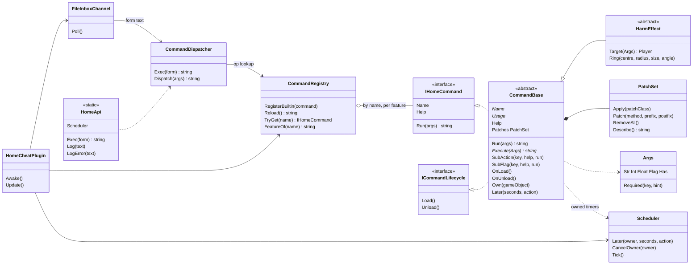
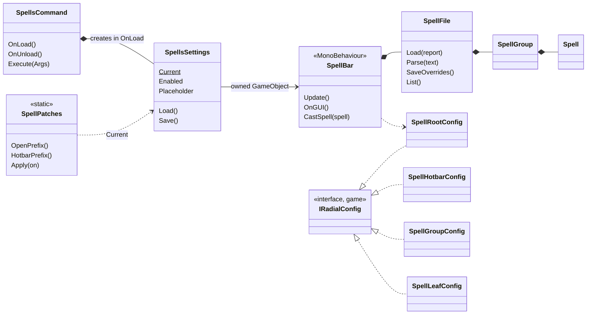

# HomeCheat architecture

Restructured 2026-10-25 from one 880-line plugin class plus flat command files. Valheim 1.0.20, BepInEx 5.4.2351, C# 5 (csc 4.0 that ships with Windows). Package: [GameplayEnhancements](../GameplayEnhancements/README.md), sources: [GameplayEnhancements/src/](../GameplayEnhancements/src/), command index: [docs/HomeCheat-plugin/README.md](../GameplayEnhancements/docs/HomeCheat-plugin/README.md). Paths below are relative to `GameplayEnhancements/`.

## Two kinds of DLL

| DLL | Holds | Changes need |
|---|---|---|
| `BepInEx/plugins/HomeCheat.dll` (core) | contracts, services, shared helpers (`Kit`), six built-ins, the tree-scale load patch | a game restart: BepInEx loads it once |
| `BepInEx/homecheat-commands/HomeCheat.Cmd.<feature>.v<yyyyMMddHHmmss>.dll` (one per feature) | the commands of one feature folder | `op=reload`, no restart |

Rules:
- The core holds what is stable. A helper moves into the core only when two or more features use it and it has stopped changing; until then it stays in its feature.
- Features never reference each other's types. They are separate assemblies, reloaded independently. One feature calls another only through `HomeApi.Exec("op=...")`, the same path the inbox uses (the spell bar does this for every cast).
- Only the newest stamp of each feature loads, compared as a number (old 6-digit `hhmmss` stamps lose to new 14-digit ones, and a build after midnight beats one before it).
- .NET 4 cannot unload an assembly. A replaced build stays in memory until the game restarts; it is unloaded logically (its patches, objects and timers are removed).

```
HomeCheat.dll (core)                                      HomeCheat.Cmd.<feature>.dll (hot reload)
 HomeCheatPlugin      Awake/Update only, wires services    Features/World        give spawn list place plant field cultivate
 Contracts            IHomeCommand, ICommandLifecycle,                           repair refill groundlevel path inspect scale
                      CommandBase, HarmEffect, PatchSet,   Features/Diag         cheatstate cheatinfo
                      HomeApi                              Features/Earthquake   earthquake      (HarmEffect)
 Pure (no Unity)      Args, CommandException, FormParser,  Features/Slime        slime           (HarmEffect)
                      BuildStamp, GridMath                 Features/Spellshot    spellshot
 Services             CommandRegistry, CommandDispatcher,  Features/Heal         heal cleanse bless
                      FileInboxChannel, Scheduler          Features/Spells       spells (bar, radial, spell file)
 Kit                  Players, Aim, Ground, Masks,         Features/Transform    transform
                      Anchor, Prefabs, Fx, Trees, Refl,    Features/HideBody     hidebody
                      Fmt                                  Features/KillMobs     killmobs
 Builtins             ping status reload commands help     Features/VisualEffect visualeffect
                      harmeffect, TreeScalePatch           Features/FxDump       fxdump
                                                           Features/Keybinds     keybinds
```

Flow of one command: `inbox/<name>.cmd` -> `FileInboxChannel` (poll 0.5 s, main thread) -> `CommandDispatcher` (form -> parameters, `op` -> command) -> `CommandRegistry` lookup -> `CommandBase.Run` (sub-action or `Execute`) -> answer text -> `outbox/<name>.out`.

## Class diagrams

### Core: contracts and services



### Who inherits what, by DLL

Every command derives from `CommandBase`; the two effects aimed at a player derive from `HarmEffect`. Nothing goes deeper.

```mermaid
classDiagram
  direction LR
  class CommandBase {
    <<abstract>>
  }
  class HarmEffect {
    <<abstract>>
  }
  CommandBase <|-- HarmEffect
  namespace core_HomeCheat_dll {
    class PingCommand
    class StatusCommand
    class ReloadCommand
    class CommandsCommand
    class HelpCommand
    class HarmEffectCommand
  }
  namespace world {
    class GiveCommand
    class SpawnCommand
    class ListCommand
    class PlaceCommand
    class PlantCommand
    class FieldCommand
    class CultivateCommand
    class RepairCommand
    class RefillCommand
    class GroundLevelCommand
    class PathCommand
    class InspectCommand
    class ScaleCommand
  }
  namespace diag {
    class CheatStateCommand
    class CheatInfoCommand
  }
  namespace spells_and_effects {
    class EarthquakeEffect
    class SlimeEffect
    class SpellShotCommand
    class HealCommand
    class CleanseCommand
    class BlessCommand
    class SpellsCommand
    class TransformCommand
    class HideBodyCommand
    class KillMobsCommand
    class VisualEffectCommand
    class FxDumpCommand
    class KeybindsCommand
  }
  CommandBase <|-- PingCommand
  CommandBase <|-- StatusCommand
  CommandBase <|-- ReloadCommand
  CommandBase <|-- CommandsCommand
  CommandBase <|-- HelpCommand
  CommandBase <|-- HarmEffectCommand
  CommandBase <|-- GiveCommand
  CommandBase <|-- SpawnCommand
  CommandBase <|-- ListCommand
  CommandBase <|-- PlaceCommand
  CommandBase <|-- PlantCommand
  CommandBase <|-- FieldCommand
  CommandBase <|-- CultivateCommand
  CommandBase <|-- RepairCommand
  CommandBase <|-- RefillCommand
  CommandBase <|-- GroundLevelCommand
  CommandBase <|-- PathCommand
  CommandBase <|-- InspectCommand
  CommandBase <|-- ScaleCommand
  CommandBase <|-- CheatStateCommand
  CommandBase <|-- CheatInfoCommand
  HarmEffect <|-- EarthquakeEffect
  HarmEffect <|-- SlimeEffect
  CommandBase <|-- SpellShotCommand
  CommandBase <|-- HealCommand
  CommandBase <|-- CleanseCommand
  CommandBase <|-- BlessCommand
  CommandBase <|-- SpellsCommand
  CommandBase <|-- TransformCommand
  CommandBase <|-- HideBodyCommand
  CommandBase <|-- KillMobsCommand
  CommandBase <|-- VisualEffectCommand
  CommandBase <|-- FxDumpCommand
  CommandBase <|-- KeybindsCommand
```



Each command in the last group is its own DLL (`earthquake`, `slime`, `spellshot`, `spells`, `transform`, `hidebody`, `killmobs`, `visualeffect`, `fxdump`, `keybinds`), except `heal`, `cleanse` and `bless`, which share the `heal` DLL.

### Composition: the spell bar (the largest feature)



A cast goes `SpellBar.CastSpell` -> `HomeApi.Exec("op=heal")` -> the dispatcher -> `HealCommand` in another DLL: features never reference each other's types.

## Main classes

| Class | Role |
|---|---|
| `HomeCheatPlugin` | BepInEx entry point. Creates the services, registers the built-ins, loads the feature DLLs, ticks the scheduler and polls the inbox. Nothing else. |
| `CommandRegistry` | every command by name and the feature that provides it; loads the newest build per feature, unloads the build it replaces, refuses a name another feature already owns |
| `CommandDispatcher` | form text -> parameters -> command -> answer; main thread only |
| `FileInboxChannel` | the file channel (`inbox/*.cmd` -> `outbox/*.out`); no network port |
| `Scheduler` | main-thread timers with an owner; unloading the owner cancels its timers |
| `HomeApi` | the one static entry point for feature code: `Exec`, `Log`, `LogError`, `Scheduler` |
| `Args` | typed parameters: `Str`, `Int`, `Float` (InvariantCulture), `Flag` (1/true/yes/aim), `Has`, `Required` (throws) |
| `CommandBase` | base of every command (below) |
| `HarmEffect` | base of effects aimed at a player: `Target(a)`, `Ring(...)`; reachable as `op=harmeffect&kind=<name>` too |
| `PatchSet` | the Harmony patches of one command under one id (`com.homeos.homecheat.<command>`); applied per patch class, removed on unload |

## Inherit or compose

OOP is used, but shallow. Unity and Valheim are built from components, and their types are not ours to subclass (the exceptions are `MonoBehaviour` and the game's `IRadialConfig`).

- **Inherit** when something is a kind of command with a shared lifecycle: every command derives from `CommandBase`; player-targeted effects derive from `HarmEffect : CommandBase`. Concrete commands are `sealed`. Nothing goes deeper than two levels.
- **Compose** when a command *has* something: Harmony patches (`Patches`), a GameObject (`Own(...)`), timers (`Later(...)`), effects (`Kit.Fx`), a grid (`Kit.Anchor`), a spell file (`SpellFile` inside the spell bar).

`CommandBase` is a template method:

```csharp
public sealed class HealCommand : CommandBase
{
    public override string Name { get { return "heal"; } }
    protected override string Usage { get { return "heal [hp=<n>] [only=hp|stamina|eitr]"; } }

    public HealCommand()                       // constructors only register sub-actions: no side effects
    {
        SubFlag("list", "list=1 (show, change nothing)", delegate (Args a) { return "..."; });
    }

    protected override string Execute(Args a)  // the main action
    {
        Player p = Players.Local;              // throws "no local player: load a world first"
        float hp = a.Float("hp", 0f);
        if (p.IsDead()) throw new CommandException("you are dead");   // answered as "ERROR: you are dead"
        return "healed ...";
    }
}
```

`Run` (not overridable) builds `Args`, tries the sub-actions in registration order (`SubAction` = key with a value, `SubFlag` = key=1), else calls `Execute`. A `CommandException` becomes `ERROR: <message>`; any other exception is logged with its stack trace and answered the same way. `Help` = `Usage` plus the help texts of the sub-actions.

## Lifecycle and hot reload

1. The registry constructs every command of the new DLL. Constructors only set fields and register sub-actions.
2. It unloads every command of the feature's previous build: `OnUnload()` first, then the base class removes the command's patches, destroys its owned GameObjects and cancels its timers (even when `OnUnload` throws).
3. It registers the new commands and calls `OnLoad()` on each: apply patches, create GameObjects, read settings files.

State lives in instance fields. Harmony patch classes are static, so they reach the loaded command through `static <Command> Current`, set in `OnLoad` and cleared in `OnUnload`; a patch does nothing while `Current` is null. Example: `KeybindsCommand.Current`, `HideBodyCommand.Current`, `SpellsSettings.Current`.

Consequences to know:
- A reload cancels the pending timers of the old build. Earthquake stones placed before the reload then never break on their own; `op=earthquake&clear=1` removes them (they are marked in their ZDO).
- `transform` takes its components off the players on unload, so a new build starts from the human form.
- `hidebody` switches itself off on unload and on quit.
- Harmony patches on game UI methods are applied only once a world is loaded, never during plugin start: the spell bar's `RadialBase.Open` / `UseHotbarItem` patches at start froze the main-scene load (2026-10-25). `SpellPatches.EnsureApplied` applies them from `SpellBar.Update` when the local player exists, or right away on an `op=reload` inside a world.
- A feature build that fails to compile leaves the previous build loaded: check that `op=reload` names the new file before testing it.

## Conventions

- One public type per file, named after the type. Namespaces: `HomeCheat` (contracts), `HomeCheat.Kit`, `HomeCheat.Services`, `HomeCheat.Builtins`, `HomeCheat.Features.<Feature>`, except where the name would hide a game or Unity type (`World` -> `WorldCommands`, `Transform` -> `TransformCommands`).
- Feature types are `internal` unless Harmony or Unity needs them public; commands are `public sealed` (the registry creates them by reflection).
- C# 5 only: no `?.`, no `$""`, no expression-bodied members, no `nameof`.
- Unity objects are compared with `== null`, never with `??`: `??` skips Unity's destroyed-object check.
- No capture of a `for` loop variable in a lambda: copy it to a local first (C# 5 fixes this only for `foreach`).
- User errors throw `CommandException` (`Args.Required`, `Players.Local`, `HarmEffect.Target`, `Prefabs.Require` do it for you). Older command code that returns an `"ERROR: ..."` answer directly gives the same result and is left as it is.
- `Fmt.Vec` and `Args` use InvariantCulture. Numbers printed with `ToString("F1")` in older answers still follow the PC's culture.
- All game access stays on the main thread; the dispatcher refuses other threads.

## Add a command

1. Pick the feature folder it belongs to (or create `src/Features/<Feature>/`; the folder name in lower case is the DLL name).
2. Add `<Name>Command.cs`: a `public sealed class` deriving from `CommandBase` (or `HarmEffect` for an effect centred on a player), with `Name`, `Usage` and `Execute`; sub-actions in the constructor.
3. Patches: one `[HarmonyPatch]` class per file, applied with `Patches.Apply(typeof(...))` in `OnLoad`, state through `Current`.
4. Extra game assemblies (Animator, AudioSource, ZInput, IMGUI ...): one line each in the folder's `refs.txt`; csc names the missing one.
5. `bash src/build.sh <feature>`, then `op=reload` in game, then `op=help&cmd=<name>`.
6. Document it: a page under `GameplayEnhancements/docs/<topic>/` and a row in the [command index](../GameplayEnhancements/docs/HomeCheat-plugin/README.md).

## Build

From Git Bash (`VALHEIM_DIR=/c/...` for another install path):

```bash
bash src/build.sh selftest     # Unity-free logic tests (form parser, Args, build stamps, grid math); no game needed
bash src/build.sh core         # BepInEx/plugins/HomeCheat.dll; refuses while valheim.exe runs
bash src/build.sh <feature>    # e.g. heal; stages HomeCheat.Cmd.heal.v<stamp>.dll, then op=reload
bash src/build.sh all          # core (if the game is closed) and every feature
```

Every build of a feature gets a new file name; the older builds stay in `homecheat-commands/` but do not load. The HomeOS package build (`scripts/valheim/packages/build.js`) takes the newest build of each feature and `src/` as it is.
