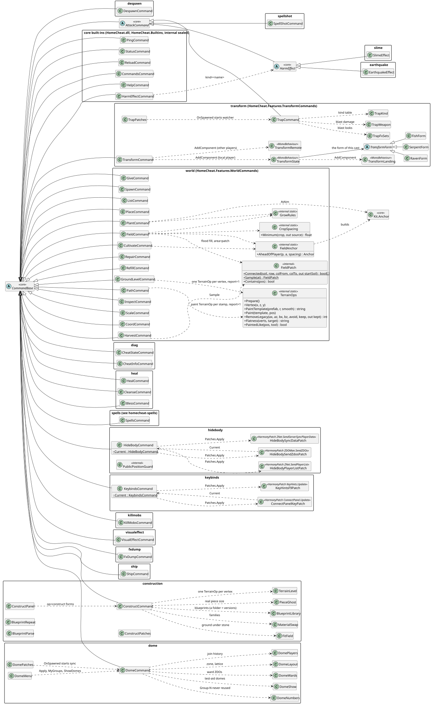
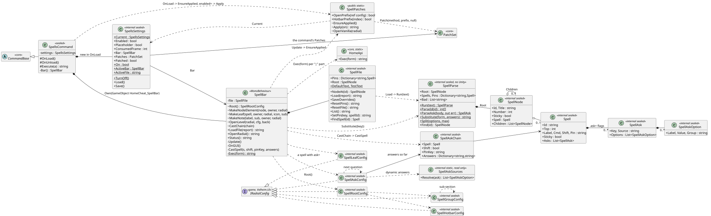

# HomeCheat architecture

Restructured 2026-10-25 from one 880-line plugin class plus flat command files. Valheim 1.0.20, BepInEx 5.4.2351, C# 5 (csc 4.0 that ships with Windows). Package: [GameplayEnhancements](../GameplayEnhancements/README.md), sources: [GameplayEnhancements/src/](../GameplayEnhancements/src/), command index: [docs/HomeCheat-plugin/README.md](../GameplayEnhancements/docs/HomeCheat-plugin/README.md), class diagrams: [diagrams/](diagrams/) (PlantUML sources and SVG). Paths below are relative to `GameplayEnhancements/`.

## Two kinds of DLL

| DLL | Holds | Changes need |
|---|---|---|
| `BepInEx/plugins/HomeCheat.dll` (core) | contracts, services, shared helpers (`Kit`), six built-ins, the tree-scale load patch | a game restart: BepInEx loads it once |
| `BepInEx/homecheat-commands/HomeCheat.Cmd.<feature>.v<yyyyMMddHHmmss>.dll` (one per feature) | the commands of one feature folder | `op=reload`, no restart |

Rules:
- The core holds what is stable. A helper moves into the core only when two or more features use it and it has stopped changing; until then it stays in its feature.
- Features never reference each other's types. They are separate assemblies, reloaded independently. One feature calls another only through `HomeApi.Exec("op=...")`, the same path the inbox uses (the spell bar does this for every cast).
- Only the newest stamp of each feature loads, compared as a number (old 6-digit `hhmmss` stamps lose to new 14-digit ones, and a build after midnight beats one before it).
- .NET 4 cannot unload an assembly. A replaced build stays in memory until the game restarts; it is unloaded logically (its patches, objects and timers are removed).

```
HomeCheat.dll (core)                                      HomeCheat.Cmd.<feature>.dll (hot reload)
 HomeCheatPlugin      Awake/Update only, wires services    Features/World        give spawn list place plant field cultivate
 Contracts            IHomeCommand, ICommandLifecycle,                           repair refill groundlevel path inspect scale
                      CommandBase, HarmEffect, PatchSet,                         + FieldAnchor CropSpacing TerrainStamp
                      HomeApi                              Features/Diag         cheatstate cheatinfo
 Pure (no Unity)      Args, CommandException, FormParser,  Features/Earthquake   earthquake      (HarmEffect)
                      BuildStamp, GridMath                 Features/Slime        slime           (HarmEffect)
 Services             CommandRegistry, CommandDispatcher,  Features/Spellshot    spellshot
                      FileInboxChannel, Scheduler          Features/Heal         heal cleanse bless
 Kit                  Players, Aim, Ground, Masks,         Features/Spells       spells (bar, radial, spell file, patches)
                      Anchor, Prefabs, Fx, Trees, Refl,    Features/Transform    transform + TransformState/Remote/Landing
                      Fmt                                  Features/HideBody     hidebody + 3 patches, PublicPositionGuard
 Builtins             ping status reload commands help     Features/KillMobs     killmobs
                      harmeffect, TreeScalePatch           Features/VisualEffect visualeffect
                                                           Features/FxDump       fxdump
                                                           Features/Keybinds     keybinds + 2 patches
```

Flow of one command: `BepInEx/config/homecheat/inbox/<name>.cmd` -> `FileInboxChannel` (poll 0.5 s, at most 20 files per poll, main thread) -> `CommandDispatcher` (form -> parameters, `op` lower-cased -> command) -> `CommandRegistry` lookup -> `CommandBase.Run` (sub-action or `Execute`) -> answer text -> `outbox/<name>.out` (written as `.tmp`, then moved).

## Class diagrams

Sources are PlantUML in [diagrams/](diagrams/). After a change, render them with `java -jar plantuml.jar -tsvg docs/diagrams/*.puml`; every file starts with `!pragma layout smetana`, so no Graphviz is needed.

### Core: contracts and services


### Who inherits what, by DLL

Every command derives from `CommandBase`; the two effects aimed at a player derive from `HarmEffect`. Nothing goes deeper. One box is one DLL; the helper types of a feature sit in its box.



Each command in the single-command boxes is its own DLL (`earthquake`, `slime`, `spellshot`, `spells`, `transform`, `hidebody`, `killmobs`, `visualeffect`, `fxdump`, `keybinds`), except `heal`, `cleanse` and `bless`, which share the `heal` DLL.

### Composition: the spell bar (the largest feature)



A cast goes `SpellBar.CastSpell` -> the spell's `Cmd` from the spell file (the Shift form appended when Shift is held), split on `;;` -> `HomeApi.Exec("op=heal")` for each part -> the dispatcher -> `HealCommand` in another DLL: features never reference each other's types.

## Main classes

| Class | Role |
|---|---|
| `HomeCheatPlugin` | BepInEx entry point. Creates the services and the dispatcher, fills `HomeApi`, hands the loaded `HomeCheat` assembly to the command DLLs (`AssemblyResolve`), applies the core `TreeScalePatch`, registers the built-ins, loads the feature DLLs, ticks the scheduler and polls the inbox. Nothing else. |
| `CommandRegistry` | every command by name and the feature that provides it; loads the newest build per feature from bytes (the file is never locked), unloads the build it replaces, refuses a name another feature already owns (the rest of that DLL still loads); the feature name `core` is reserved for the built-ins |
| `CommandDispatcher` | form text -> parameters -> command -> answer; main thread only |
| `FileInboxChannel` | the file channel (`inbox/*.cmd` -> `outbox/*.out`); no network port |
| `Scheduler` | main-thread timers with an owner, on `Time.time` (they wait while the game is paused); unloading the owner cancels its timers |
| `HomeApi` | the one static entry point for feature code: `Exec`, `Log`, `LogError`, `Scheduler` |
| `Args` | typed parameters: `Str`, `Int`, `Float` (InvariantCulture), `Flag` (1/true/yes/aim; empty or missing = the default), `Has`, `Required` (throws), `Raw` (a copy, to forward to another command) |
| `CommandBase` | base of every command (below) |
| `HarmEffect` | base of effects aimed at a player: `Target(a)`, `Ring(...)`; reachable as `op=harmeffect&kind=<name>` too |
| `PatchSet` | the Harmony patches of one command under one id (`com.homeos.homecheat.<command>`); applied per patch class (`Apply`) or per method found by reflection (`Patch`), removed on unload |

## Inherit or compose

OOP is used, but shallow. Unity and Valheim are built from components, and their types are not ours to subclass. The exceptions are `BaseUnityPlugin` (the plugin), `MonoBehaviour` (`SpellBar`, `TransformState`, `TransformRemote`, `TransformLanding`) and the game's `IRadialConfig` (the four `Spell*Config` classes).

- **Inherit** when something is a kind of command with a shared lifecycle: every command derives from `CommandBase`; player-targeted effects derive from `HarmEffect : CommandBase`. Concrete commands are `sealed`. Nothing goes deeper than two levels.
- **Compose** when a command *has* something: Harmony patches (`Patches`), a GameObject (`Own(...)`), timers (`Later(...)`), effects (`Kit.Fx`), a grid (`Kit.Anchor`), a spell file (`SpellFile` inside the spell bar).

`CommandBase` is a template method. `RepairCommand` (shortened) shows every part:

```csharp
public sealed class RepairCommand : CommandBase
{
    public RepairCommand()                     // constructors only register sub-actions: no side effects
    {
        SubFlag("report", "report=1 [radius=10] (health of every piece around you, changes nothing)",
            delegate (Args a) { return Report(a.Float("radius", 10f)); });
    }

    public override string Name { get { return "repair"; } }
    protected override string Usage { get { return "repair [aim=1] [radius=10 (with aim=0)] [amount=0 (= full)] - building pieces back to full health"; } }

    protected override string Execute(Args a)  // the main action
    {
        bool aim = a.Flag("aim", true);
        Player p = Players.Local;              // throws "no local player: load a world first"
        float radius = a.Float("radius", 10f);
        if (!aim && radius <= 0f) throw new CommandException("radius must be > 0");   // answered as "ERROR: radius must be > 0"
        return "repaired ...";
    }
}
```

`Run` (not overridable) builds `Args`, tries the sub-actions in registration order (`SubAction` = the key has a non-empty value, `SubFlag` = the key is 1, true, yes or aim), else calls `Execute`. A `CommandException` becomes `ERROR: <message>`; any other exception is logged with its stack trace and answered the same way. `Help` = `Usage` plus the help texts of the sub-actions, joined with ` | `.

## Lifecycle and hot reload

1. The registry loads the new DLL from bytes and constructs every non-abstract `IHomeCommand` type with a public parameterless constructor. Constructors only set fields and register sub-actions. A command whose name another feature (or a built-in) owns is dropped here, with a `FAILED` line in the answer.
2. It unloads every command of the feature's previous build: `OnUnload()` first, then the base class cancels the command's timers, removes its patches and destroys its owned GameObjects (even when `OnUnload` throws).
3. It registers the new commands and calls `OnLoad()` on each: apply patches, create GameObjects, read settings files. A command whose `OnLoad` throws stays registered; the answer shows `FAILED load of <name>`.

Built-ins are registered once by the plugin and get `OnLoad()` at that moment; they are never replaced.

State lives in instance fields. Harmony patch classes are static, so they reach the loaded command through `static <Command> Current`, set in `OnLoad` and cleared in `OnUnload`; a patch does nothing while `Current` is null. Example: `KeybindsCommand.Current`, `HideBodyCommand.Current`, `SpellsSettings.Current`.

Consequences to know:
- A reload cancels the pending timers of the old build. Earthquake stones placed before the reload then never break on their own; `op=earthquake&clear=1` removes them (they are marked in their ZDO).
- `transform` takes its components off the players on unload, so a new build starts from the human form.
- `hidebody` switches itself off on unload and on quit.
- Harmony patches on game UI methods are applied only once a world is loaded, never during plugin start: the spell bar's `RadialBase.Open` / `UseHotbarItem` patches at start froze the main-scene load (2026-10-25). `SpellPatches.EnsureApplied` applies them from `SpellBar.Update` when the local player exists, or right away on an `op=reload` inside a world; `op=spells&enabled=1` inside a world applies them through `SpellPatches.Apply`. If applying fails, spells switch off and `spells.state` remembers it.
- A feature build that fails to compile leaves the previous build loaded: check that `op=reload` names the new file before testing it.

## Feature notes (2026-10-25)

Behaviour that shapes the code, checked in game on 2026-10-25. The full parameters are in each command's help (`op=help&cmd=<name>`) and the [command index](../GameplayEnhancements/docs/HomeCheat-plugin/README.md).

- **World grid anchors.** `cultivate` and `field` lay their grid from the player (`FieldAnchor.AheadOfPlayer`): row 1 is your own cell (`dist=0` by default), centred on your flat look direction, rows running away from you. Both use the same anchor, so the crops land exactly on the cultivated cells. `plant` and `place` still start at the crosshair (`Kit.Anchor`).
- **field spacing.** Without `spacing=`, `field` uses the crops' minimum legal distance from the game's data (`CropSpacing`): the sapling's `m_growRadius` plus its collider radius, the largest over all crops in `crops=` (carrot 0.68 m). Fallback 1.5 m.
- **field plants only connected soil.** Only cultivated cells joined to your own cell through cultivated cells (all 8 neighbours) are planted. A gap of uncultivated soil ends the field there; with your cell uncultivated nothing is planted. `map=1` prints the grid (`@` your cell, `#` connected, `o` cut off, `.` no soil). Limits: 40 000 cells examined, 2 500 crops planted.
- **Terrain commands** reuse the game's hoe pieces (`TerrainStamp`): the piece's `TerrainModifier` radii are changed for the spawn and restored right after.
- **earthquake damage.** `damage=0` (default) only pushes. With `damage>0` every slam carries a hammer's damage: `weapon=SledgeStagbreaker` by default; `mode=strong` takes `SledgeDemolisher` and pushes 8.4 instead of 2.1; `weapon=auto` = the strongest `Sledge*` item (not `SledgeCheat`); `quality=max` by default, damage = base + per level x (quality - 1).
- **slime** casts effect set 2 by default (`fx=2`).
- **repair** has `report=1 [radius=10]`: the health of every piece around you, read from the ZDO, changing nothing.
- **cheatstate** reads, besides the achievement, terminal and profile flags: the player's debug-fly, god and ghost state, inventory items marked cheated, and cheated items, ragdolls and creatures within `radius=25`.

## Conventions

- One public type per file, named after the type. Namespaces: `HomeCheat` (contracts and the Unity-free `Pure` types), `HomeCheat.Kit`, `HomeCheat.Services`, `HomeCheat.Builtins`, `HomeCheat.Features.<Feature>`, except where the name would hide a game or Unity type (`World` -> `WorldCommands`, `Transform` -> `TransformCommands`).
- Feature types are `internal` unless Harmony or Unity needs them public (`SpellPatches`, whose prefixes are found with `GetMethod`; the `MonoBehaviour` classes). Feature commands are `public sealed`; the registry creates them by reflection and needs a public parameterless constructor. The six built-ins are `internal sealed`: the plugin creates them itself.
- C# 5 only: no `?.`, no `$""`, no expression-bodied members, no `nameof`.
- Unity objects are compared with `== null`, never with `??`: `??` skips Unity's destroyed-object check.
- No capture of a `for` loop variable in a lambda: copy it to a local first (C# 5 fixes this only for `foreach`).
- User errors throw `CommandException` (`Args.Required`, `Players.Local`, `HarmEffect.Target`, `Prefabs.Require` do it for you). Older command code that returns an `"ERROR: ..."` answer directly gives the same result and is left as it is.
- `Fmt.Vec` and `Args` use InvariantCulture. Numbers printed with `ToString("F1")` in older answers still follow the PC's culture.
- All game access stays on the main thread; the dispatcher refuses other threads.

## Add a command

1. Pick the feature folder it belongs to (or create `src/Features/<Feature>/`; the folder name in lower case is the DLL name).
2. Add `<Name>Command.cs`: a `public sealed class` deriving from `CommandBase` (or `HarmEffect` for an effect centred on a player), with `Name`, `Usage` and `Execute`; sub-actions in the constructor.
3. Patches: one `[HarmonyPatch]` class per file, applied with `Patches.Apply(typeof(...))` in `OnLoad` (or when the command switches the feature on, as `hidebody` does), state through `Current`. A patch whose target must be found by reflection, or that may only go in once a world is loaded, uses `Patches.Patch(method, prefix, postfix)` (see `SpellPatches`).
4. Extra game assemblies (Animator, AudioSource, ZInput, IMGUI ...): one `valheim_Data/Managed` file name per line in the folder's `refs.txt` (`# comment` lines and blank lines are skipped); csc names the missing one.
5. `bash src/build.sh <feature>` (needs the core installed: `bash src/build.sh core` once), then `op=reload` in game, then `op=help&cmd=<name>`.
6. Document it: a page under `GameplayEnhancements/docs/<topic>/` and a row in the [command index](../GameplayEnhancements/docs/HomeCheat-plugin/README.md).

## Build

From Git Bash. The game folder defaults to `/d/steam/steamapps/common/Valheim`; set `VALHEIM_DIR=/c/...` for another install path. Builds go to `${TMPDIR:-/tmp}/homecheat-build` first and are then copied into the game; csc's CS0618 (obsolete game API) warnings are hidden.

```bash
bash src/build.sh selftest     # Core/Pure + SelfTest only, no game references: form parser, Args, build stamps, grid math; exit 0 = all passed
bash src/build.sh core         # BepInEx/plugins/HomeCheat.dll; refuses while valheim.exe runs
bash src/build.sh <feature>    # e.g. heal (folder name, any case); stages HomeCheat.Cmd.heal.v<stamp>.dll, then op=reload
bash src/build.sh all          # core (if the game is closed) and every feature
```

Every build of a feature gets a new file name; the older builds stay in `homecheat-commands/` but do not load. The HomeOS package build (`scripts/valheim/packages/build.js`) takes the newest build of each feature and `src/` as it is, and stops when a feature folder has no build or a build has no folder.
